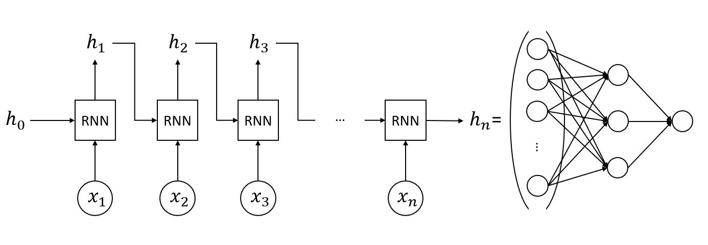
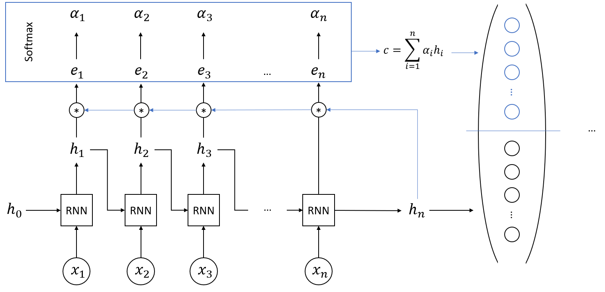

<!-- source: https://wiki.pmifi.ru/disciplines/nlp/laboratory-works/attention -->
<!-- updated: 2025-12-01T09:23:32.261Z -->
<!-- author: Иван Бугаенко -->

# Реализация внимания в RNN

## Задание

- Реализовать механизм внимания для решения задачи классификации текстов из ЛР №2.

## Ход работы

1. Возьмите за основу код для решения задачи классификации из второй лабораторной работы. Архитектура вашего решения выглядит примерно таким образом.

2. Создайте attention-слой (используя метод `forward()` и наследование от `nn.Module`), который на вход принимает все скрытые состояния (переменная out) и финальное скрытое состояние (переменная h), а возвращает вектор $c = [h_n | \sum_{i=1}^{n}\alpha_i h_i]$, где:

   - $e_i = h_{i}^{T} \cdot h_n = \langle h_{i}, h_n\rangle, i=1...n$ (скалярное произведение скрытых состояний с итоговым скрытым состоянием);
   - $\alpha_i = \frac{\exp{(e_i)}}{\sum_{j=1}^{n}e_j}, i=1...n$ (softmax-коэффициенты, полученные для скалярных произведений $e_i$);
   - $[a | b]$ -- конкатинация векторов-столбцов $a$ и $b$ (в данном случае появляется больше строк, столбец остается один).
3. Интегрируйте разработанный слой внимания во все три архитектуры нейронных сетей (с использованием RNN, LSTM и GRU), при этом входом полносвязного блока для осуществления классификации будет тот самый вектор $c$. Архитектура будет выглядеть примерно так.

4. Посчитайте метрики и сравните их с исходными (без использования слоя внимания).

## Критерии приема работы

- Сформирован слой внимания.
- Разработанный слой встроен в архитектуры RNN, LSTM и GRU из ЛР №2.
- Выполнено сравнение метрик.
