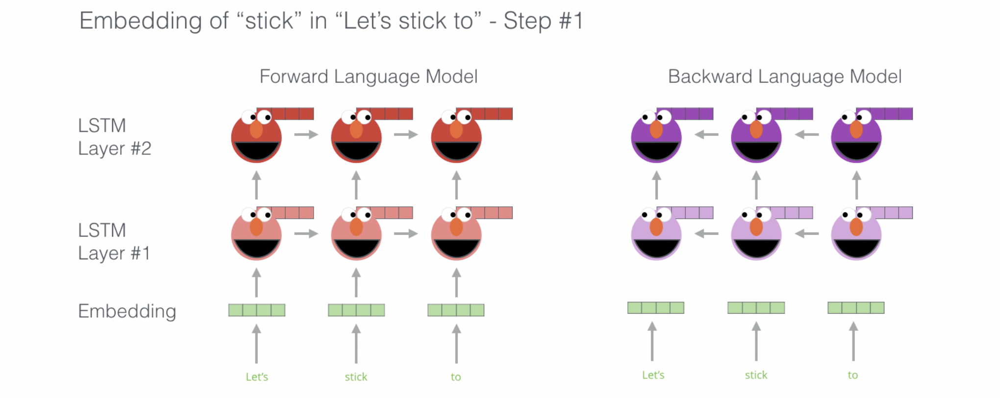
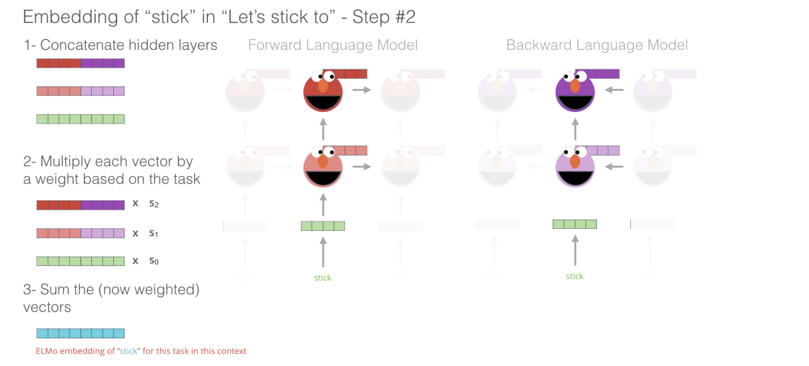

<!-- source: https://wiki.pmifi.ru/disciplines/nlp/lectures/bert-gpt-2 -->
<!-- updated: 2026-10-02T03:41:35.091Z -->
<!-- author: Михаил Гуненков -->

# Transfer Learning Трансформеров (BERT, GPT) V2

В лекции используются иллюстрации [из блога Jay Alammar](https://jalammar.github.io/).

## Введение

Трансферное обучение (Transfer Learning) — фундаментальная парадигма в современном машинном обучении. Ключевая идея заключается в том, чтобы модели могли **использовать знания**, полученные при решении одной задачи (исходной), для повышения производительности на другой задаче (целевой).

> Этот подход устраняет необходимость обучать каждую модель с нуля

В NLP часто применяется двухэтапное трансферное обучение.

**Предварительное обучение (Pre-training)**  
Модель обучается на большой, как правило, неразмеченной коллекции текстовых данных для решения общей задачи (моделирование языка). На этом этапе модель извлекает фундаментальные лингвистические закономерности, синтаксические структуры и семантические отношения.

**Адаптация (Adaptation)**  
Предварительно обученная модель адаптируется для решения конкретной целевой задачи (классификация текстов, ответы на вопросы, машинный перевод). Адаптация может происходить двумя способами:

- **путем извлечения признаков** (feature extraction), когда веса предобученной модели замораживаются, а ее внутренние представления используются как признаки для нового классификатора
- **путем дообучения** (fine-tuning), когда все или часть весов модели настраиваются на размеченных данных целевой задачи

Несколько крупных организаций с огромными вычислительными ресурсами (Google и OpenAI) взяли на себя этап предварительного обучения универсальных базовых моделей (`backbones`). А исследовательское сообщество получило возможность использовать предварительно обученные модели для множества прикладных задач с гораздо меньшими вычислительными затратами.

> Это демократизировало доступ к передовым технологиям, но централизовало создание фундаментальных моделей

## Embeddings from Language Models (ELMo)

Модель ELMo [представлена исследователями из AllenNLP](https://arxiv.org/abs/1802.05365). Это первый шаг к созданию контекстнозависимых векторных представлений для отдельных токенов.

В самом простом варианте ELMo использует глубокую двунаправленную языковую модель, построенную на основе двухслойной сети LSTM. Предварительно обучается на **стандартной задаче языкового моделирования**: предсказании следующего слова в последовательности (для прямого LSTM) и предыдущего слова (для обратного LSTM). Финальное представление для токена является взвешенной линейной комбинацией внутренних состояний всех слоев (причем веса подбираются для каждой конкретной задачи).

Общая формула получения векторного представления токена $k$ в рамках целевой задачи имеет вид:

$\text{ELMo}_k^{\text{task}} = \gamma^{\text{task}} \sum_{j=0}^{L} s_j^{\text{task}} h_{k,j}^{\text{LM}},$

где $s_j^{\text{task}}$ — softmax-нормализованные веса для каждого слоя $j$ (от входных эмбеддингов до верхнего слоя LSTM), а $\gamma^{\text{task}}$ — обучаемый скалярный параметр, который позволяет масштабировать весь вектор ELMo для конкретной задачи.

> **Ключевое открытие:** разные слои захватывают разные уровни лингвистической информации

Нижние слои, как правило, моделируют синтаксические аспекты, такие как части речи, в то время как верхние слои улавливают более сложные, семантически зависимые от контекста значения (ассоциируем со сверточными нейронными сетями в CV). ELMo создал гибкий механизм для **извлечения наиболее релевантной информации** для каждой конкретной задачи.

## Интерлюдия

Архитектура Трансформер послужила основой для двух стратегий предварительного обучения.

**Автокодирующие модели (Auto-Encoding)**  
Обучаются восстанавливать исходные данные из их поврежденной версии (с замаскированными токенами). Могут одновременно видеть всю входную последовательность (контекст как слева, так и справа), что делает их мощными для задач понимания языка (Natural Language Understanding, NLU). Используют **только кодировщик** (encoder-only) Трансформера.

**Авторегрессионные модели (Auto-Regressive)**  
Эти модели обучаются предсказывать следующий токен в последовательности, основываясь на всех предыдущих токенах. Они однонаправленные (слева направо) и хорошо работают в задачах генерации текста (Natural Language Generation, NLG). Используют **только декодировщик** (decoder-only) Трансформера.

## Bidirectional Encoder Representations from Transformers (BERT)

Модель от компании Google, которая [была представлена в конце 2018 года](https://arxiv.org/abs/1810.04805). Это набор последовательно соединенных кодировщиков, выполненных в соответствие с классической архитектурой Трансформер.

.png)

Оригинальная модель BERT была представлена в двух вариантах:

- BERT Base (12 кодировщиков, эмбеддинги размеров 768, 12 голов в Multi-Head Self-Attention)
- BERT Large (24 кодировщика, эмбеддинги размеров 1024, 16 голов в Multi-Head Self-Attention)

Обучение обычно реализуется **в два этапа**:

.png)

Для предварительного обучения используются **две уникальные задачи**.

**Маскированная языковая модель (Masked Language Model, MLM)**  
В процессе обучения случайным образом выбирается 15% токенов во входной последовательности, они заменяются на специальный токен `<MASK>`.

Задача модели — предсказать исходный токен на месте этих измененных токенов. Такая стратегия заставляет модель формировать богатые контекстуальные представления для каждого токена в последовательности.

.png)

**Предсказание следующего предложения (Next Sentence Prediction, NSP)**  
Модель получает на вход пару предложений (A и B) и должна предсказать, является ли предложение B реальным продолжением предложения A в исходном тексте. В 50% случаев B является истинным следующим предложением, а в остальных 50% — случайным предложением из корпуса (выборка обычно сбалансирована). Для разделения используется специальный токен `<SEP>`.

.png)

Можем **использовать выходы BERT** в качестве контекстнозависимых векторных представлений текстовых токенов (по аналогии с ELMo):

.png)

Иногда следует **применять промежуточные эмбеддинги** (вспоминаем ELMo, смотрим пример для задачи распознавания именованных сущностей):

.png)

Можем ввести специальный токен `<CLS>` и использовать его векторное представление как **эмбеддинг всей последовательности** (текста):

.png)

## Generative Pre-trained Transformer (GPT)

Представлена [в исследовании группы ученых компании OpenAI 2018 года](https://cdn.openai.com/research-covers/language-unsupervised/language_understanding_paper.pdf).

Сегодня под GPT понимается семейство decoder-only моделей.

Предварительно обучается с использованием стандартной цели языкового моделирования: предсказать следующий токен, имея на входе все предыдущие токены.

Рассмотрим на примере GPT-2 (веса открыты):

.png)

.png)

Все модели GPT 2 могут обрабатывать до 1024 токенов (считая входную последовательность).

| Характеристика | BERT (Bidirectional Encoder Representations from Transformers) | GPT (Generative Pre-trained Transformer) |
| --- | --- | --- |
| **Архитектура** | Только кодировщик (Encoder-Only) | Только декодер (Decoder-Only) |
| **Задача пред. обучения** | Маскированная языковая модель (MLM) и предсказание след. предложения (NSP) | Авторегрессионное языковое моделирование (CLM) |
| **Обработка контекста** | Двунаправленная (видит контекст слева и справа) | Однонаправленная (видит только левый контекст) |
| **Механизм внимания** | Полное самовнимание (Full Self-Attention) | Маскированное самовнимание (Masked Self-Attention) |
| **Основное преимущество** | Понимание языка, классификация, извлечение (NLU) | Генерация языка, дополнение текста (NLG) |
| **Типичные применения** | Анализ тональности, ответы на вопросы, распознавание именованных сущностей | Чат-боты, саммарзация, генерация кода |

## Сжатие языковых моделей

Модели BERT-Large (340 млн параметров) и GPT-3 (175 млрд параметров) являются вычислительно дорогими и требуют огромного объема памяти. Это делает их развертывание сложной задачей. Решение — **дистилляция знаний**.

Концепция предложена [в исследовании 2015 года (до появления трансформеров)](https://arxiv.org/abs/1503.02531).

Метод сжатия, при котором маленькая модель ("ученик") обучается имитировать поведение большой, предварительно обученной модели ("учителя"). Цель в том, чтобы передать знания от учителя к ученику.

> Знания учителя содержатся **не только в его окончательных предсказаниях** (жестких метках, hard labels), но и в полном распределении вероятностей по всем классам (мягких метках, soft labels)

Чтобы получить более мягкое и информативное распределение вероятностей из логитов учителя ($z_i$) в функцию `softmax` вводится гиперпараметр "температура" $T$:

$q_i = \frac{\exp(z_i/T)}{\sum_j \exp(z_j/T)}$

Когда $T > 1$, распределение становится более "мягким", усиливая вероятности для менее вероятных классов и предоставляя более богатый обучающий сигнал для ученика. При $T = 1$ функция сводится к стандартному `softmax`.

Модель-ученик стремится минимизировать функцию потерь, которая является **взвешенной суммой двух компонент:**

- потери дистилляции (кросс-энтропия) с мягкими метками от учителя, вычисленными при высокой температуре $T$
- стандартные потери (кросс-энтропия) с истинными жесткими метками, вычисленными при $T=1$

$L = \alpha \cdot L_{\text{soft}}(p^T, p^S) + (1 - \alpha) \cdot L_{\text{hard}}(y_{\text{true}}, p^S),$

где $p^T$ и $p^S$ — мягкие распределения вероятностей учителя и ученика соответственно, а $y_{\text{true}}$ — one-hot закодированные истинные метки. Параметр $\alpha$ контролирует баланс между двумя компонентами потерь.

Ярким примером применения дистилляции знаний к модели в архитектуре Трансформер является DistilBERT ([оригинальное исследование 2019 года](https://arxiv.org/abs/1910.01108)).

.png)

DistilBERT обучается с использованием комбинированной функции потерь, которая включает три компоненты:

- потери дистилляции ($L_{ce}$): кросс-энтропия между выходами softmax (с температурой) ученика и учителя
- потери маскированной языковой модели ($L_{mlm}$): стандартная функция потерь MLM
- косинусные потери для векторных представлений ($L_{cos}$): косинусное расстояние между векторами скрытых состояний ученика и учителя (для "имитации мыслительного процесса" учителя)

> В современном NLP люди поняли, что **все необходимые знания уже есть в текстах**. Никакой особенной разметки не нужно - модели просто должны научиться находить эти знания

Скажем несколько слов **про квантование моделей**.

Каждый параметр модели — число, которое обычно хранится в формате float32 (32 бита).

> 8,000,000,000 параметров × 4 байта (32 бита) = 32,000,000,000 байт = 32 ГБ

Для запуска такой модели нужно 32 ГБ видеопамяти (VRAM). Квантование предполагает **замену точных 32-битных чисел менее точными**, 8-битными или 4-битные целыми числами (int8, int4). При квантовании в int8 (8 бит = 1 байт) та же модель будет весить 8 ГБ. При квантовании в int4 (4 бита = 0.5 байта) — 4 ГБ.

**Как делать:**

- анализируем все веса и находим их минимальное и максимальное значения `(например, -1.0 и 1.0)`
- создаем линейную карту, чтобы сопоставить диапазон вещественных чисел `[-1.0, 1.0]` с целочисленным диапазоном `[-128, 127]`
- каждое исходное вещественное число (вес) преобразуется в целое:

  - 1.0 превратится в 127
  - -1.0 превратится в -128
  - 0.0 превратится в 0
  - 0.5 превратится примерно в 64

> Когда нужно выполнить вычисления модель будет "де-квантовать" эти числа обратно в вещественные. Но 64 не станет ровно 0.5. **Будет потеря в точности**

## Parameter-Efficient Fine-Tuning

Полное дообучение больших моделей стоит дорого. При обучении с оптимизатором Adam в памяти приходится держать не только сами веса, но и их моменты (первый и второй). Плюс для каждой новой задачи требуется хранить свою **полную копию** модели.

Сегодня популярностью пользуется метод **LoRA (Low-Rank Adaptation)**, [предложенный исследователями Microsoft в 2021 году](https://arxiv.org/abs/2106.09685). Ключевое наблюдение: матрица обновления весов $\Delta{W}$ при адаптации к конкретной задаче имеет низкий ранг — большая часть информации в ней избыточна. Значит, обновление можно **аппроксимировать произведением двух узких матриц**.

Веса предобученной модели $W_0 \in \mathbb{R}^{k \times d}$ замораживаются, а обновление представляется низкоранговым разложением $\Delta W = BA$, где $B \in \mathbb{R}^{k \times r}$ и $A \in \mathbb{R}^{r \times d}$ — две обучаемые матрицы, а $r \ll \min(k, d)$.

Прямой проход через слой принимает вид:

$h = W_0 x + \frac{\alpha}{r} BAx,$

где $\alpha$ — гиперпараметр масштаба, который управляет тем, насколько сильно адаптер влияет на выход слоя (отношение $\alpha / r$ нормирует вклад $\Delta W$).

## Выводы и еще кое-что

> Использование кодировщиков и декодировщиков в одной модели во многих случаях **избыточно**

> Использование кодировщиков и декодировщиков по отдельности позволяет получать модели **для решения самых разных задач NLP**

Просто предсказывать следующеее слово в огромном веб-корпусе недостаточно, чтобы гарантировать, что модель будет полезной (главное, безвредной). **Проблемой является согласование** (alignment): приведение поведения модели в соответствие с намерениями и ценностями человека.

**Применяются две техники выравнивания:**

**Обучение на инструкциях (Instruction Tuning):** дообучение моделей на наборах данных, состоящих из инструкций и желаемых ответов (InstructGPT на основе GPT 3, [оригинальное исследование 2022 года](https://arxiv.org/abs/2203.02155)).

**Обучение с подкреплением на основе обратной связи от человека** (Reinforcement Learning from Human Feedback, RLHF): современный стандарт (ChatGPT, 30 ноября 2022).

Три этапа:

1. Дообучение языковой модели с учителем (Supervised Fine-Tuning, SFT): предварительно обученная на веб-корпусах модель дообучается на небольшом наборе высококачественных демонстраций, написанных человеком
2. Обучение модели вознаграждения (Reward Model, RM): люди ранжируют несколько ответов языковой модели на один и тот же запрос; отдельная модель вознаграждения обучается предсказывать оценки, поставленные человеком (функция награды в RL)
3. Дообучение с подкреплением (RL Fine-Tuning): языковая модель дообучается методами RL (как правило методом Proximal Policy Optimization (PPO)), при этом модель вознаграждения возвращает сигнал (награду) для корректировки функции потерь языковой модели

Пара статей про "взлом LLM" (обход alignment):

- [Adversarial suffixes или можно ли получить ответ на любой вопрос от LLM?](https://habr.com/ru/companies/raft/articles/790848/)
- [Как обмануть LLM: обход защиты при помощи состязательных суффиксов](https://habr.com/ru/companies/oleg-bunin/articles/950318/)
