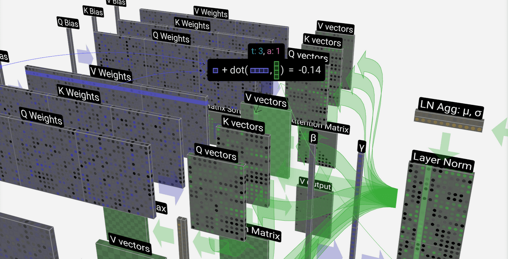
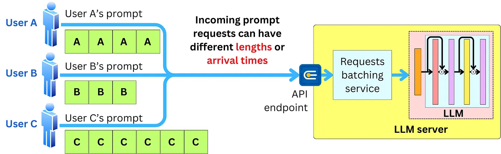
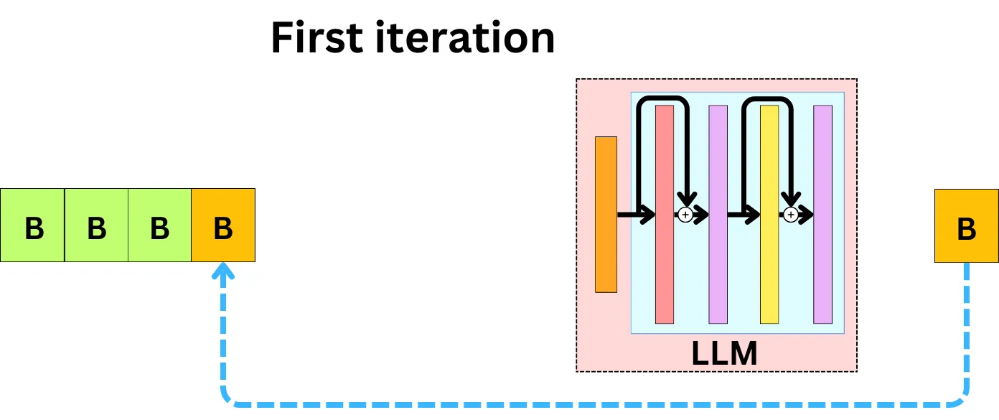
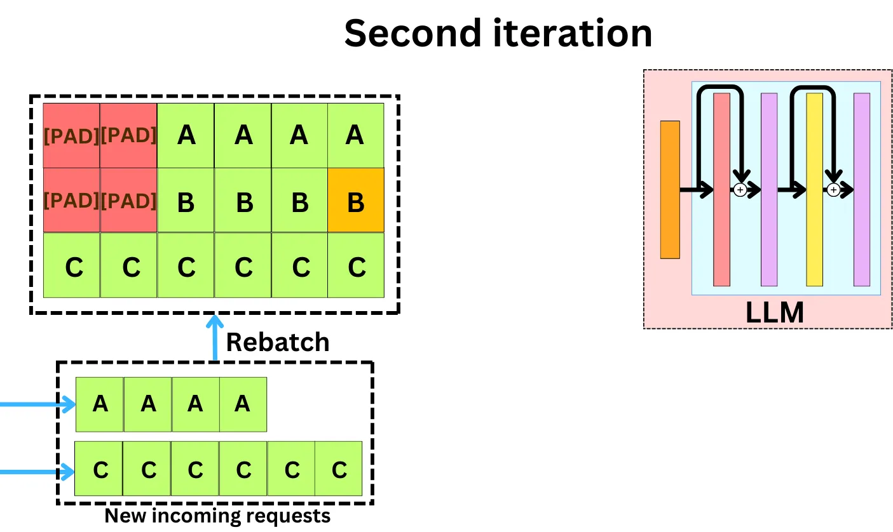
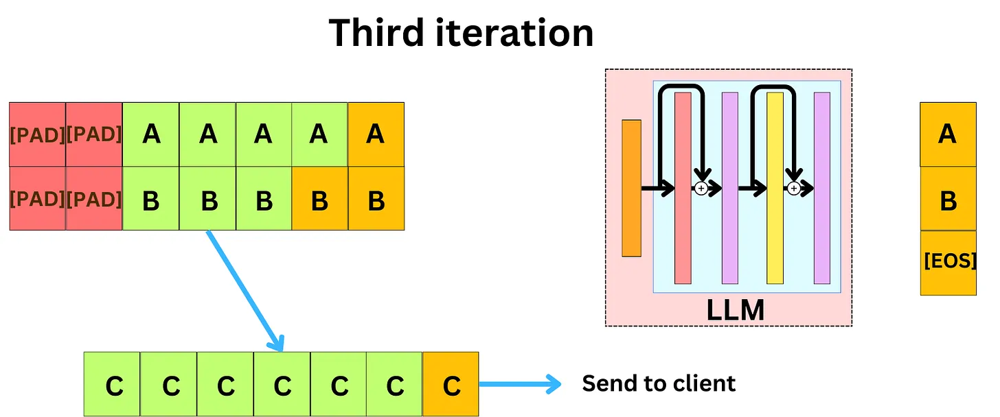
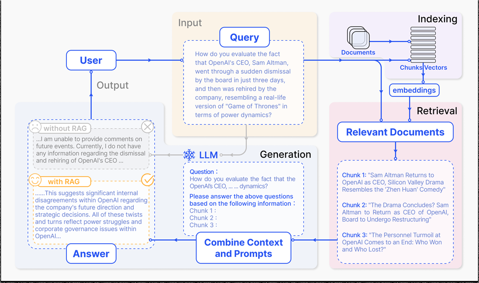
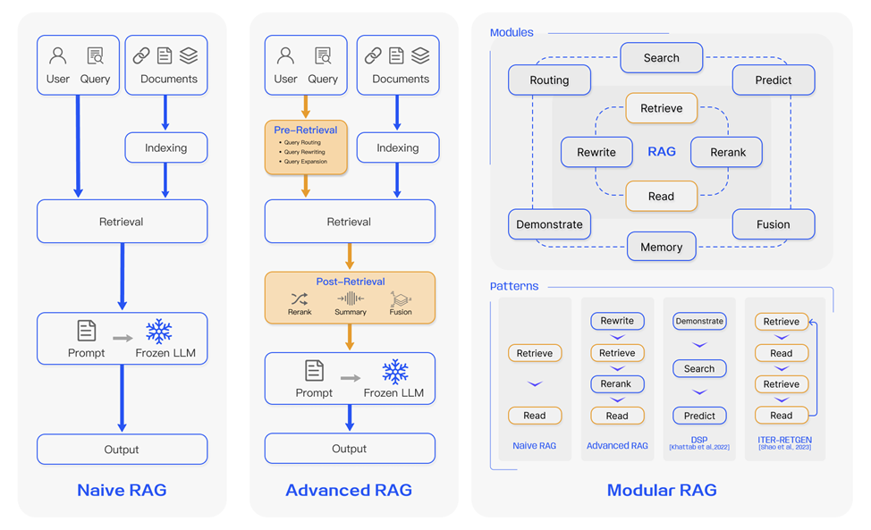
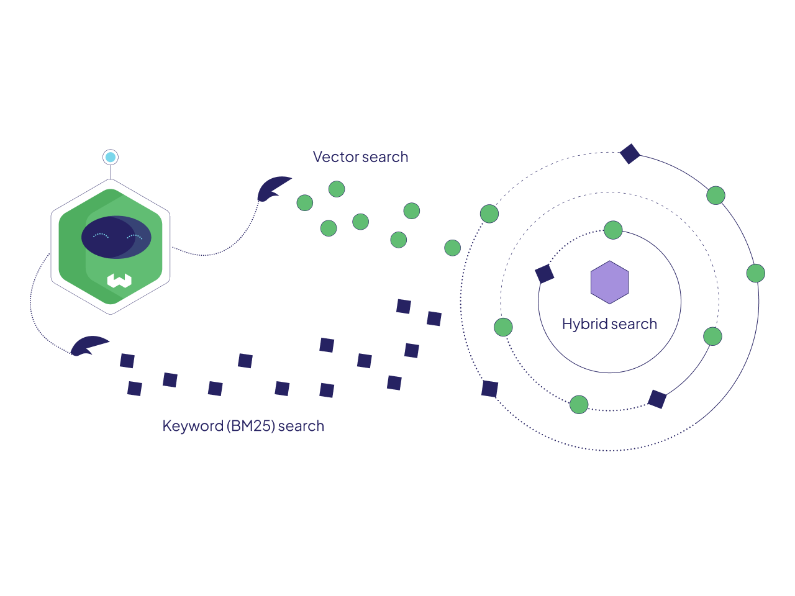
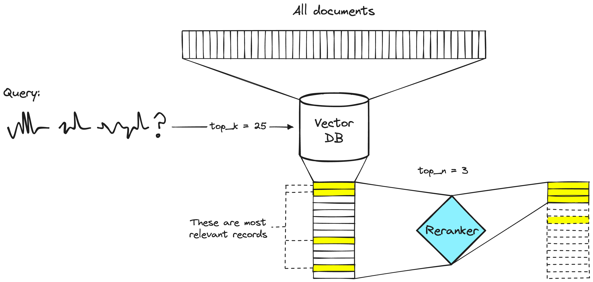
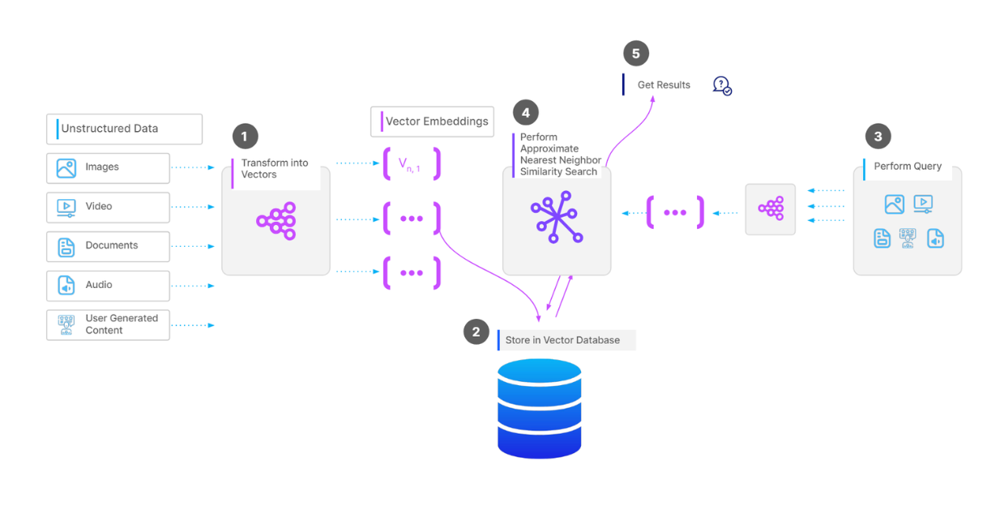

<!-- source: https://wiki.pmifi.ru/disciplines/nlp/lectures/llms -->
<!-- updated: 2025-10-31T18:33:04.576Z -->
<!-- author: Михаил Гуненков -->

# Основы LLM и RAG

## Большие языковые модели

**Большую языковую модель** (Large Language Model, LLM) можно определить как модель, обученную с помощью самоконтролируемого обучения (self-supervised learning) на большом объеме текстовых данных с целью авторегрессионного предсказания следующего токена (слова или части слова) в последовательности.

> Определяющей характеристикой таких моделей является масштаб: количество параметров (весов) исчисляется миллиардами, иногда триллионами



[Сайт с визуализациями некоторых LLM в 3D](https://bbycroft.net/llm)

### Параметрические знания

Ключевая концепция заключается, что знания, которыми обладает LLM, хранятся не в базе данных, а закодированы непосредственно в ее параметрах. Это явление получило название [параметрических знаний (Parametric Knowledge)](https://aclanthology.org/2025.acl-long.1047.pdf).

Информационные потоки LLM доступны и могут быть проанализированы. Можно изучать, как и где модель хранит информацию. В ходе исследований выявлялись конкретные паттерны весов внутри FFNN-слоев моделей, которые хранили фактические знания. Демонстрировалось, что ручное вмешательство в значения весов может напрямую изменять факты, которые помнит модель.

> Современная теория: знания локализованы, факты не размазаны по всей модели, а хранятся в конкретных, идентифицируемых частях (можно дополнительно посмотреть [алгоритмы ROME и MEMIT](https://arxiv.org/abs/2403.14236))

Концепция параметрических знаний подразумевает, что знания LLM статичны. Они кодируются в миллиардах числовых параметров во время этапа предварительного обучения. Знания заморожены на момент завершения обучения, что напрямую ведет к **проблеме предела знаний** (knowledge cutoff).

**Предел знаний** — точка во времени, после которой модель не обучалась на новых данных. Любая информация о событиях, произошедших после этой даты, отсутствует во внутренней базе знаний модели (имеются в виду параметрические знания).

Модель GPT-4 имеет предел знаний в сентябре 2021 года; ее более новая версия, GPT-4 Turbo обновлена до декабря 2023 года. Модели Llama 4 имеют предел знаний в августе 2024 года.

### Статистическая природа

Модели генерируют токены авторегрессионно на основе полученных из начальных эмбеддингов логитов. При этом используются различные техники семплирования, которые мы уже знаем.

**Здесь стоит сказать о температуре** (один из гиперпараметров, влияет на креативность), которая часто упоминается в контексте LLM. Мы уже сталкивались с ней, когда говорили про дистилляцию знаний.

$p_i = \frac{e^{z_i/T}}{\sum_{j=1}^{|V|} e^{z_j/T}}$

Влияние температуры на распределение:

- при $T \to 0$, деление на малое число делает большие логиты еще больше, а маленькие — еще меньше; распределение становится очень острым; в пределе этот метод сходится к жадному поиску, делая вывод детерминированным
- при $T = 1$ получаем стандартную функцию Softmax без изменений
- при $T > 1$, логиты сглаживаются, уменьшая разницу между вероятностями частых и редких токенов; Это делает распределение более равномерным, повышая шансы на выбор менее очевидных токенов

> Модель оптимизируется исключительно на **воспроизведение статистических закономерностей** из обучающих данных. Наиболее вероятное не означает наиболее правдивое

Эти факты являются причинами того, что **LLM галлюцинируют** или генерируют правдоподобно звучащие, но ложные утверждения. Модель завершает шаблон на основе своих обучающих данных, не имея внутреннего представления об истине.

> RAG является основной техникой, используемой для **заземления модели на внешние данные**, что значительно снижает частоту галлюцинаций.

### Бенчмарки для LLM

Если раньше было достаточно оценить модель на конкретной задаче (анализ тональности), то теперь с появлением моделей общего назначения возникла необходимость в более широкой оценке. Это привело к созданию **многозадачных бенчмарков**.

**Категории бенчмарков:**

- общая эрудиция: [MMLU, 2020](https://arxiv.org/abs/2009.03300) (Massive Multitask Language Understanding) — тест из 57 предметов (математика, история, право, физика, философия и т.д.) на уровне от школы до аспирантуры
- оценка логики: [HellaSwag, 2019](https://arxiv.org/abs/1905.07830) — модели дается начало ситуации, и она должна выбрать самое логичное из четырех предложенных завершений
- профессиональные навыки в узких областях: [HumanEval, 2021](https://arxiv.org/abs/2107.03374) — модели дается описание функции на Python, и она должна написать работающий код
- безопасность: [TruthfulQA, 2021](https://arxiv.org/abs/2109.07958) — модели задается набор хитрых вопросов, где самый распространенный в интернете ответ является неверным

Все эти (и многие другие) бенчмарки можно оценивать с помощью фреймворка [DeepEval](https://deepeval.com/).

Отдельного упоминания достойны LLM-арены. Это слепой турнир, где люди (иногда и другие модели) выступают в роли судей и сравнивают ответы двух анонимных моделей и выбирая лучший (у выбранной модели рейтинг повышается, а у проигравшей — понижается).

> Невозможно подготовить модель к арене, потому что промпты — **непредсказуемые запросы** от реальных пользователей. Люди голосуют, основываясь на субъективных, но важных вещах: креативность, стиль, юмор, глубина понимания и др.

Примеры арен:

- <https://lmarena.ai/>
- <https://llmarena.ru/>

### Инференс-движки

Это специализированные сервера (приложения), предназначенные для эффективного (с точки зрения используемой памяти и в целом ресурсов компьютера) запуска LLM.

Известные примеры:

- [vLLM](https://github.com/vllm-project/vllm)
- [Text Generation Inference (TGI)](https://github.com/huggingface/text-generation-inference)
- [Ollama](https://ollama.com/)

Некоторые технологии повышения эффективности запуска LLM:

- квантование (о нем уже говорили) и приближенные вычисления
- KV-кэширование (KV Caching): ключи и значения для уже обработанных токенов кэшируются, чтобы избежать их повторного вычисления на каждом шаге
- Continuous Batching









## Retrieval Augmented Generation (RAG)

RAG — **шаблон проектирования** систем с применением технологий генеративного ИИ, который соединяет LLM с внешней, проверяемой и актуальной базой знаний (векторные БД).



Подходы к RAG со временем [эволюционировали](https://habr.com/ru/articles/893650/).



> Только векторный (семантический) поиск не всегда может не найти документы, содержащие значимые ключевые слова (коды продуктов, имена, сообщения об ошибках). Сегодня повсеместно применяется **гибридный поиск**



**Извлечение по ключевым словам**  
[Алгоритм Okapi BM25, впервые представлен в 1970-х](https://www.staff.city.ac.uk/~sbrp622/papers/foundations_bm25_review.pdf) — прокаченная версия TF-IDF:

$\text{Score}(Q, D) = \sum_{i=1}^{n} \text{IDF}(q_i) \cdot \frac{f(q_i, D) \cdot (k_1 + 1)}{f(q_i, D) + k_1 \cdot (1 - b + b \cdot \frac{|D|}{\text{avgdl}})}$

Здесь:

- $IDF(q_i)$: обратная частота документа для термина запроса $q_i$; придает больший вес более редким терминам; формула: $\log\left(\frac{N - n(q_i) + 0.5}{n(q_i) + 0.5} + 1\right)$, где $N$ — общее число документов, а $n(q_i)$ — число документов, содержащих $q_i$
- $f(q_i, D)$: Частота термина $q_i$ в документе $D$
- $|D|$: длина документа $D$ в словах
- `avgdl`: Средняя длина документа в коллекции
- $k_1$: Параметр (предложены значения 1.2-2.0), который контролирует насыщение частоты термина; предотвращает доминирование в оценке терминов с очень высокой частотой
- $b$: Параметр (предложено значение 0.75), который контролирует степень нормализации по длине документа

Для объединения оценок от BM25 и векторного поиска используются методы, такие как [Reciprocal Rank Fusion, 2024 (RRF)](https://arxiv.org/abs/2402.03367). Имеем два списка. Для каждого документа в каждом списке балл рассчитывается как:

$\text{Балл} = \frac{1}{k + \text{ранг}}$

- ранг: позиция документа в списке
- $k$: константа (предложено значение 60), которая используется для сглаживания

> Если документ отсутствует в данном списке, то он получает оценку 0

Поиск в огромном корпусе из миллионов документов требует чрезвычайной эффективности. Первый этап должен быть быстрым. Первичный ретривер находит в векторной БД набор потенциально релевантных документов (топ-100). **Реранкер** — модель, которая берет первоначальный список извлеченных документов и переупорядочивает их на основе более вычислительно затратного, но точного расчета релевантности.



> Для переранжирования используется подход bi-encoding (вспоминайте BERT, два предложения на входе через разделитель, совместную обработку и ответ — насколько предложения подходят).

Пример продвинутого RAG с [LangChain](https://www.langchain.com/):

```python
import os
from langchain_core.documents import Document
from langchain_core.runnables import RunnablePassthrough
from langchain_core.output_parsers import StrOutputParser
from langchain.prompts import ChatPromptTemplate
from langchain.retриvers import BM25Retriever
from langchain_community.vectorstores import FAISS
from langchain_community.embeddings import HuggingFaceBgeEmbeddings
from langchain.retrievers.document_compressors import ReciprocalRankFuser
from langchain_community.cross_encoders import HuggingFaceCrossEncoder
from langchain_community.chat_models import GigaChat

docs = [
    Document(page_content="Фрукты - это здорово. Яблоки хрустящие и сладкие."),
    Document(page_content="Бананы желтые и мягкие. Отличный источник калия."),
    Document(page_content="Гуненков - хороший коллега"),
    Document(page_content="Яблоки богаты витамином C и клетчаткой."),
    Document(page_content="Калий - химический элемент, полезный для сердца."),
]

bm25_retriever = BM25Retriever.from_documents(docs)
bm25_retriever.k = 2

embeddings = HuggingFaceBgeEmbeddings(
    model_name="deepvk/USER-bge-m3"
)
vectorstore = FAISS.from_documents(docs, embeddings)
faiss_retriever = vectorstore.as_retriever()

fuser = ReciprocalRankFuser(c=60)
reranker_model = HuggingFaceCrossEncoder(model_name="qilowoq/bge-reranker-v2-m3-en-ru")

def hybrid_rrf_retriever(query: str):
    bm25_docs = bm25_retriever.get_relevant_documents(query)
    faiss_docs = faiss_retriever.get_relevant_documents(query)
    
    fused_results = fuser.compress_documents(
        query=query,
        documents_lists=[bm25_docs, faiss_docs]
    )
    return fused_results

def rerank_docs(input_dict: dict):
    query = input_dict['question']
    fused_docs = input_dict['fused_docs']
    
    pairs = [(query, doc.page_content) for doc in fused_docs]
    scores = reranker_model.score(pairs)
    
    doc_with_scores = list(zip(fused_docs, scores))
    doc_with_scores.sort(key=lambda x: x[1], reverse=True)
    
    # 3 лучших документа пойдут в LLM
    reranked_docs = [doc for doc, score in doc_with_scores[:3]]
    return "\n\n".join([d.page_content for d in reranked_docs])

try:
    llm = GigaChat(temperature=1, verify_ssl_certs=False)
except Exception as e:
    print(f"Ошибка инициализации GigaChat")
    exit()

template = """
Ты полезный ИИ-ассистент. Отвечай на вопрос пользователя, 
опираясь *только* на предоставленный ниже контекст.

Контекст:
{context}

Вопрос:
{question}
"""
prompt = ChatPromptTemplate.from_template(template)

full_rag_chain = {
    "fused_docs": hybrid_rrf_retriever,
    "question": RunnablePassthrough()
} | {
    "context": rerank_docs,
    "question": lambda x: x['question']
} | prompt | llm | StrOutputParser()

query = "Что ты знаешь про Гуненкова?"

try:
    response = full_rag_chain.invoke(query)
    print(response)
```

## Векторные базы данных

Современный семантический поиск построен на основе векторных баз данных ( Pinecone, Milvus, Weaviate, Chroma, Qdrant, расширение pgvector для PostgreSQL). Это специальные БД, предназначенные для **хранения многомерных данных** (векторных представлений) с возможностью быстрого поиска по запросу ближайших соседей.



Исчерпывающий поиск в больших векторных пространствах вычислительно невозможен. Необходимы алгоритмы **приблизительного поиска ближайших соседей** (Approximate Nearest Neighbor, ANN).

**[Hierarchical Navigable Small World, 2016](https://arxiv.org/abs/1603.09320) (HNSW)**

Строится многоуровневая графовая структура.

Взяли 100 миллионов документов (всю Википедию), разбили на чанки и превратили каждый чанк в вектор. Пользователь задает вопрос: "Что такое фотосинтез?".

Сначала HNSW берет все 100 миллионов векторов и раскладывает их на Уровне 0.

- каждый вектор — узел в графе.
- каждый узел HNSW соединяет только с несколькими его ближайшими соседями

Далее:

- Уровень 1: HNSW случайным образом продвигает часть узлов с Уровня 0 на Уровень 1 (1 из 100); строятся дальние связи между этими узлами
- Уровень 2: HNSW "продвигает" часть узлов с Уровня 1 (1 из 100)
- Уровень 3 (Верхний): здесь могут оказаться только несколько узлов (главные концепции)

Получаем:

- Уровень 3: "Наука" <---> "Искусство"
- Уровень 2: "Биология" <---> "Физика" | "Литература" <---> "Музыка"
- Уровень 1: "Фотосинтез" <---> "Генетика" | "Шекспир" <---> "Толстой"
- Уровень 0: все 100 млн векторов, где "Фотосинтез" <---> "Хлорофилл"

Приходит запрос "Что такое фотосинтез?"

- Уровень 3: запрос ближе к Науке или Искусству? К Науке
- Уровень 2: от Науки куда ближе? К Биологии или Физике? К Биологии
- Уровень 1: от нее куда ближе? К Фотосинтезу или Генетике? К "Фотосинтезу"
- Уровень 0: просто ищем нескольких ближайших соседей

> Вместо того чтобы искать по всему пространству (Уровень 0) важно найти в нем подходящую точку для старта

**[Inverted File, 2022](https://arxiv.org/pdf/2210.05521) (IVF-Flat)**

Алгоритм разбивает векторное пространство на кластеры (k-means). Каждый вектор приписывается к одному из кластеров. Индекс БД хранит центроиды кластеров и список векторов, принадлежащих каждому кластеру.

При поиске соседей для вектора запроса алгоритм сначала находит ближайшие центроиды кластеров, а затем выполняет исчерпывающий поиск только в этих нескольких кластерах, что резко сокращает пространство поиска.

> Эти алгоритмы можно комбинировать (IVF-HNSW в FAISS)
