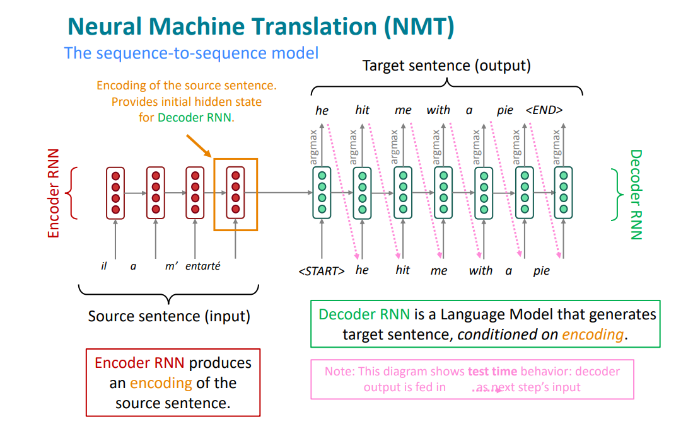
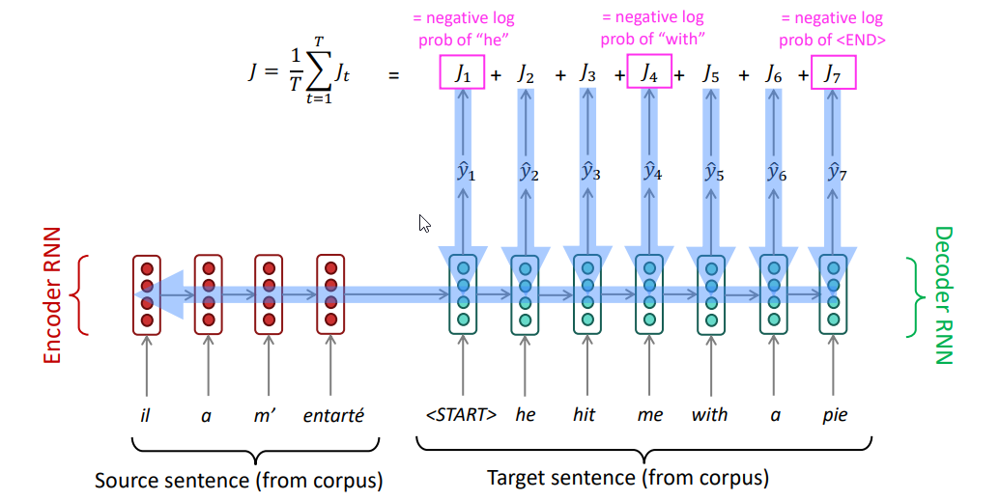
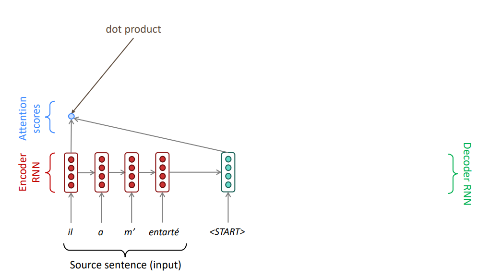
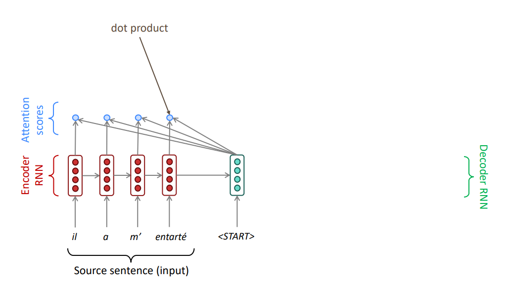
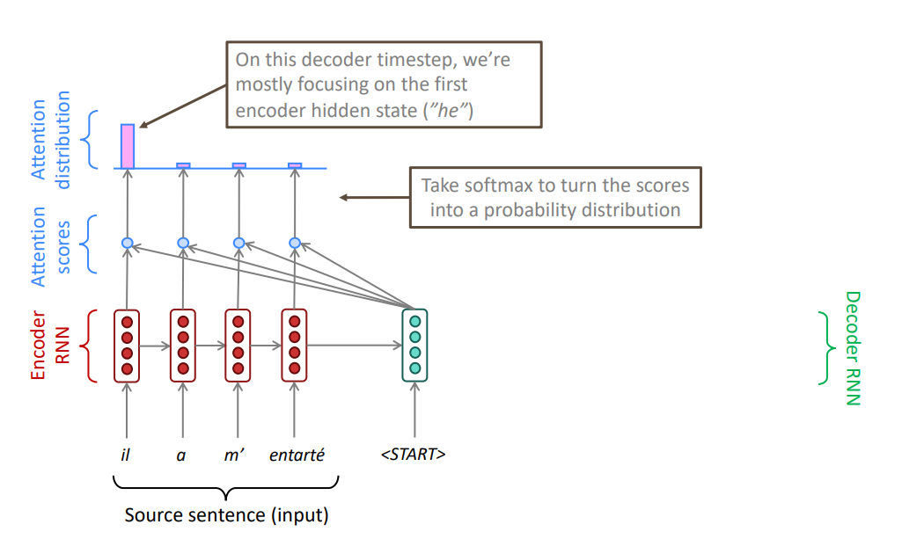
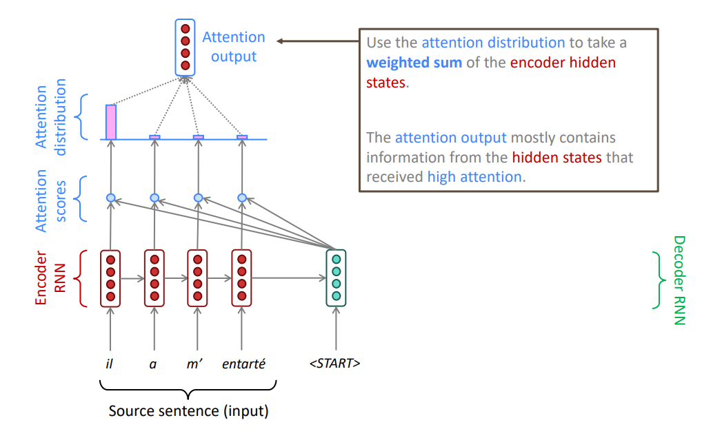
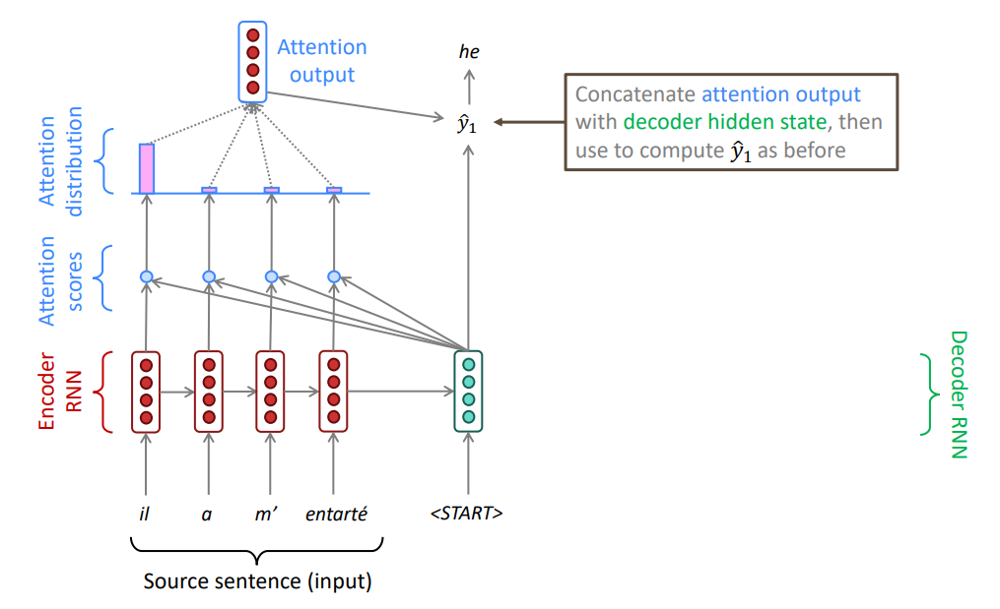
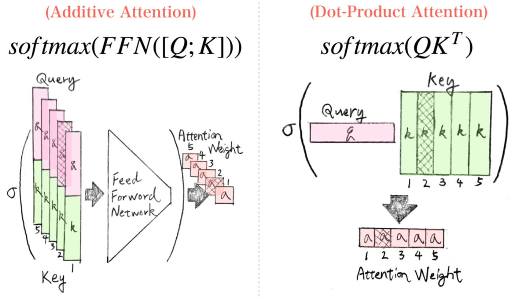

<!-- source: https://wiki.pmifi.ru/disciplines/nlp/lectures/nmt-2 -->
<!-- updated: 2026-09-24T18:35:15.293Z -->
<!-- author: Михаил Гуненков -->

# Архитектура Encoder-Decoder. Нейронный машинный перевод (V2)

## Статистический машинный перевод

### Теория

Задача машинного перевода (Machine Translation — MT) — это задача перевода текста $x$ с одного языка (исходный язык) к тексту $y$ на другом языке (целевом языке). До середины 2010-х годов доминирующей технологией в этой области был **статистический машинный перевод** (Statistic SMT).

SMT, в частности его фразовая версия (Phrase-Based SMT, PB-SMT), представляет собой подход, в котором перевод рассматривается как задача поиска наиболее вероятного предложения на целевом языке с учетом исходного предложения. Вероятность вычисляется на основе статистических данных, собранных из огромных объемов параллельных текстов.

Основная идея PB-SMT заключается в том, что **переводятся не отдельные слова, а целые фразы** (последовательности слов). Это позволяет лучше справляться с идиомами, локальными изменениями порядка слов и словосочетаниями, которые не переводятся дословно. Процесс перевода — это сложный поиск наилучшей "мозаики" из переведенных фраз.

Система PB-SMT состоит из нескольких независимо обученных моделей, которые работают вместе **в процессе, называемом декодированием**.

**Модель перевода (Phrase Table)**  
Двуязычный словарь фраз. Для каждой фразы из исходного языка он содержит список ее возможных переводов на целевой язык, каждому из которых присвоена вероятность. Например, для английской фразы `"a beautiful girl"` в таблице могут быть такие русские варианты, как `"красивая девушка"` (высокая вероятность) и `"прекрасная девочка"` (более низкая вероятность). Эти вероятности рассчитываются на основе того, как часто данные пары фраз встречались вместе в параллельном корпусе текстов.

**Модель языка (Language Model)**  
Оценивает, насколько грамматически правильным является сгенерированное предложение на целевом языке. Она ничего не знает об исходном тексте. Модель языка обучается только на больших объемах текстов на целевом языке (например, на миллионах русских статей). Обычно работает на основе N-грамм, предсказывая вероятность появления следующего слова, зная предыдущие N-1 слов. Например, она присвоит высокую вероятность фразе `"сидит на стуле"` и очень низкую — `"сидит стуле на"`.

**Модель переупорядочивания (Reordering Model).**  
Языки имеют разный порядок слов (прилагательное перед существительным в английском и русском, но после в французском). Она учится на том, как фразы в параллельных текстах меняют свои позиции при переводе. При переводе с немецкого, где глагол часто стоит в конце предложения, модель научится перемещать его на второе место в русском или английском.

### Пример

Нужно перевести с английского на русский предложение: `"My name is John"`.

**Сегментация.** Система разбивает исходное предложение на возможные фразы. Это может быть несколько вариантов: ["My name", "is", "John"] или ["My", "name is", "John"].

**Поиск переводов (Модель перевода).** Для каждой фразы из каждого варианта сегментации система ищет соответствия в таблице фраз:

`"My name"` → `"Меня зовут"` (вероятность 0.8), `"Мое имя"` (вероятность 0.2)

`"is"` → "есть" (вероятность 0.5), `""` (пустой перевод, вероятность 0.3)

`"John"` → `"Джон"` (вероятность 0.9)

**Генерация гипотез.** Декодер начинает комбинировать эти переводы, создавая множество потенциальных предложений (гипотез). Он также учитывает разные варианты порядка фраз (хотя в этом простом примере порядок сохраняется).

Гипотеза 1: `"Меня зовут"` + `""` + `"Джон"` → `"Меня зовут Джон"`

Гипотеза 2: `"Мое имя"` + `"есть"` + `"Джон"` → `"Мое имя есть Джон"`

Гипотеза 3: `"Мое имя"` + `""` + `"Джон"` → `"Мое имя Джон"`

**Каждая гипотеза оценивается всеми моделями**

Модель перевода суммирует вероятности выбранных переводов фраз. Гипотеза 1 использует перевод "Меня зовут" с высокой вероятностью (0.8).

Модель языка оценивает получившиеся русские предложения. Фраза `"Меня зовут Джон"` очень распространена в русском языке и получит высокую оценку. `"Мое имя есть Джон"` — грамматически верная, но звучит менее естественно и получит оценку ниже. `"Мое имя Джон"` также является естественной и получит хорошую оценку.

Модель переупорядочивания в данном случае не накладывает штрафов, так как порядок фраз не менялся.

**Выбор лучшего перевода.** Декодер вычисляет итоговый балл для каждой гипотезы, комбинируя оценки всех моделей. Гипотеза, набравшая максимальный балл, выбирается в качестве окончательного перевода. Cкорее всего победит "Меня зовут Джон" благодаря высокой вероятности в модели перевода и высокой гладкости в модели языка.

### Нейронный машинный перевод

В 2014-2015 годах произошла революция и появилился нейронный машинный перевод (Neural MT, NMT). Вместо конвейера из множества компонентов используется одна большая нейросеть, которая обучается сквозным образом (end-to-end).

> Фундаментальная задача NMT — **напрямую смоделировать условную вероятность** получения правильного перевода $Y$ при наличии исходного предложения $X$

Системы SMT строились на статистических принципах, которые были до некоторой степени интерпретируемы. Исследователь мог изучить таблицы фраз или вероятности языковой модели, чтобы понять, почему система приняла то или иное решение. NMT сворачивает все эти функции в единую нейронную сеть ("черный ящик").

**Центральная задача** — **Sequence-to-Sequence (Seq2Seq)**, отображение входной последовательности переменной длины (предложение на одном языке) в выходную последовательность переменной длины (предложение на другом языке). Первой архитектурой для решения этой задачи стала **Encoder-Decoder**.

### Обзор архитектуры

Концепция практически одновременно предложена в работах:

- [Sequence to Sequence Learning with Neural Networks (Sutskever et al., 2014)](https://arxiv.org/abs/1409.3215)
- [Learning Phrase Representations using RNN Encoder–Decoder for Statistical Machine Translation (Cho et al., 2014)](https://arxiv.org/abs/1406.1078)

**Две RNN**. Одна (Кодировщик, Encoder) читает исходное предложение и сжимает его смысл в единый вектор. Другая (Декодировщик, Decoder) использует этот вектор, чтобы написать новое предложение.

> Конечное скрытое состояние кодировщика является начальным состоянием декодировщика

> Для решения задачи машинного перевода целесообразно применять рекуррентные нейронные сети вида Many to Many



> Для каждого текущего токена на исходном языке модель предсказывает (**задача классификации**) следующий токен на целевом языке

Модели Seq2Seq применяются при решении самых разных задач обработки естественного языка:

- суммаризация (длинный текст → краткий текст)
- генерация кода (естественный язык → код Python)
- генерация текста (начало истории → продолжение истории)

Кодировщик обрабатывает входную последовательность токенов $x = (x_1, x_2, ..., x_T)$ один за другим. На каждом временном шаге $t$ скрытое состояние $h_t$ обновляется на основе предыдущего скрытого состояния $h_{t-1}$ и текущего входного токена $x_t$. осле обработки всей входной последовательности до последнего токена $x_T$ **финальное скрытое состояние кодировщика $h_T$ принимается за представление всего предложения**. Этот вектор фиксированного размера называется вектором контекста (context vector) $c$.

Декодировщик функционирует как языковая модель. Его задача — сгенерировать целевую последовательность $y = (y_1, y_2, ..., y_{T'})$ токен за токеном.

> Начальное скрытое состояние декодировщика $s_0$ инициализируется вектором контекста $c$, полученным от кодировщика ($s_0 = c$)

На первом шаге ($t = 1$) декодировщик принимает специальный токен начала предложения `<sos>` (Start of Sequence) и свое начальное скрытое состояние $s_0$ для предсказания первого токена целевого предложения $y_1$. На каждом последующем шаге $t$ он принимает в качестве входа сгенерированный на предыдущем шаге токен $y_{t-1}$ и предыдущее скрытое состояние $s_{t-1}$, чтобы сгенерировать следующий токен $y_t$. Этот процесс продолжается до тех пор, пока не будет сгенерирован токен конца предложения `<eos>` (End of Sequence).

### Обучение модели

Общая функция потерь $J(\theta)$ для одной пары исходного и целевого предложений вычисляется как сумма отрицательных логарифмов вероятностей (через `Softmax`) для каждого правильного слова в целевой последовательности:

$J(\theta) = - \sum_{t=1}^{T'} \log P(y_t | y_{<t}, c)$

Здесь:

- $J(\theta)$ — итоговая ошибка (потери) для одной последовательности, которую стремимся минимизировать
- $T'$ — длина целевой последовательности (количество токенов в правильном переводе)
- $t$ — текущий шаг генерации
- $y_t$ — правильный токен на шаге $t$
- $y_{<t}$ — последовательность правильных токенов перед шагом $t$, то есть $(y_1, y_2, ..., y_{t-1})$.
- $c$ — вектор контекста, полученный от кодировщика
- $P(y_t | y_{<t}, c)$ — это вероятность, которую модель (декодировщик) присвоила **правильному** токену $y_t$ на шаге $t$, получив на вход предыдущие токены и контекст



Генерация следующего токена на целевом языке опирается на результат предыдущей генерации. Поэтому, если модель предскажет неверный токен в середине предложения, все последующие токены будут предсказываться также неверно.

Для устранения этой проблемы применяется подход **Teacher Forcing**.

Обучение реализуется следующим образом:

- берем текст на исходном языке и прогоняем его через кодировщик
- подаем на первом шаге в декодировщик специальный токен `<sos>`
- предсказываем с помощью декодировщика первый токен предложения на целевом языке
- используя гиперпараметр `Teacher Forcing` (от 0 до 1) случайным образом определяем, будем ли мы далее на вход декодировщику подавать предсказанный ранее токен или будем подавать истинный токен
- продолжаем генерацию

Таким образом, модель будет учиться предсказывать следующие токены не накапливая ошибку.

### Оценка качества

Самой распространенной метрикой является **BLEU** (Bilingual Evaluation Understudy).

> Чем ближе машинный перевод к профессиональному человеческому переводу, тем он лучше

Сначала вычисляется модифицированная точность n-грамм (униграмм, биграмм, триграмм, 4-грамм) в машинном переводе по сравнению с некоторым эталонным переводом. "Модификация" вводит простое правило: нельзя засчитывать одно и то же слово больше раз, чем оно встречается в эталонном переводе.

```
Эталонный перевод: "мальчик пошел в магазин за хлебом"
Машинный перевод: "хлебом хлебом хлебом хлебом хлебом"
```

Далее нужно учитывать переводы, которые слишком коротки по сравнению с эталонными, так как короткие предложения могут иметь искусственно высокую точность.

$BP = \begin{cases}
1 & \text{if } c > r \\
e^{(1-r/c)} & \text{if } c \le r
\end{cases}$

где $c$ — длина машинного перевода, а $r$ — длина эталонного перевода.

Итоговая оценка — геометрическое среднее точностей для разных $n$, умноженное на штраф за краткость.

$BLEU = BP \cdot \exp\left(\sum_{n=1}^{N} w_n \log p_n\right)$

где $w_n$ — веса (обычно равномерные, $1/N$).

**На практике достичь оценки 1 почти невозможно**, и даже перевод, выполненный другим профессиональным переводчиком, не всегда получит максимальный балл, так как могут использоваться разные синонимы и конструкции. Поэтому для интерпретации результатов используют следующую шкалу:

- `<0.1`: бесполезный перевод
- `0.1–0.2`: суть уловить можно, но с трудом; много грамматических и смысловых ошибок
- `0.3–0.39`: понятный и в целом приемлемый перевод
- `0.4–0.5`: качественный перевод
- `>0.5`: очень качественный перевод, близкий к человеческому

### Оценка перевода с помощью LLM-as-a-Judge

BLEU сравнивает совпадение n-грамм с эталоном, но не проверяет смысл непосредственно. Если допустимы разные формулировки одного и того же перевода, полезно дополнить корпусную метрику оценкой смысловой точности и ошибок в отдельных предложениях. Один из способов такой оценки — LLM-as-a-Judge ([исследование 2023 года](https://aclanthology.org/2023.wmt-1.64/)).

**LLM-as-a-Judge** — подход, при котором языковой модели дают исходный текст и перевод-кандидат и просят оценить качество перевода по заданным критериям. Эталонный перевод можно предоставить дополнительно, но проверка сохранения смысла требует сопоставления кандидата прежде всего с исходным текстом. Модель может указать пропуски, добавления, ошибки в именах и числах, а также неестественные формулировки. В отличие от одного числа BLEU, такой ответ позволяет увидеть предполагаемую причину низкого качества.

Для `My name is John` варианты `Меня зовут Джон` и `Моё имя — Джон` различаются по словам, но оба передают исходный смысл. Judge должен оценивать не только сходство с единственным эталоном, но и точность относительно оригинала.

Практический запрос к модели:

```
Ты оцениваешь качество машинного перевода с английского на русский.

Исходный текст:
{source}

Перевод-кандидат:
{translation}

Сначала проверь сохранение смысла исходного текста.
Затем проверь пропуски, добавления, отрицания, имена,
числа, терминологию и естественность русского языка.

Для каждой найденной ошибки укажи:
1. фрагмент исходного текста;
2. фрагмент перевода;
3. тип ошибки;
4. серьёзность: minor, major или critical;
5. краткое объяснение.

Не считай ошибкой корректную переформулировку,
которая сохраняет смысл. Не выдумывай ошибки,
если перевод корректен. Верни результат в JSON.
```
> Оценку LLM следует использовать как дополнение, а не замену BLEU и проверки человеком

## Механизм внимания

> Вся суть исходного предложения, независимо от его длины или сложности, должна быть сжата в единый вектор контекста c фиксированного размера

Это создает **"бутылочное горлышко" информации** (information bottleneck). По мере увеличения длины предложения модели становится все труднее сохранить всю необходимую информацию. Информация из начала предложения может быть забыта к моменту, когда RNN обработает его конец. Это приводит к резкому падению качества перевода для длинных предложений.

Проблема информационного "бутылочного горлышка" была главным препятствием на пути к созданию высококачественного NMT. Решением стал **механизм внимания** (attention mechanism) — идея, которая не только кардинально улучшила машинный перевод, но и полностью перевернула NLP.

Нормальный переводчик не читает все исходное предложение, не запоминает его целиком, а затем пишет перевод. Он фокусируется на разных частях исходного текста по мере того, как переводит разные фрагменты целевого предложения. Механизм внимания стремится дать нейронной сети способность **динамически "обращать внимание" на наиболее релевантные части** исходного предложения на каждом шаге генерации перевода.

> Вместо схемы, где вся информация упаковывается в один вектор, механизм внимания превращает кодировщик в своего рода "базу данных с возможностью **запроса**"

Кодировщик формирует не один вектор, а последовательность векторов — по одному на каждый токен исходного текста. На каждом шаге декодировщик может "отправить запрос" в эту "базу данных" векторов и извлечь наиболее релевантную информацию для генерации следующего токена.

**Основная идея механизма внимания:** на каждом шаге декодирования использовать связи со всеми скрытыми состояниями кодировщика для того, чтобы фокусироваться (обращать внимание) не только на всю входную последовательность, но и на отдельные подпоследовательности.







Получаем n чисел, где n — количество токенов входной последовательности. Применяем softmax.





> Механизм внимания построен на концепции **запросов** (queries), **ключей** (keys) и **значений** (values)

- **Query (Запрос):** в RNN это скрытое состояние декодера, которое "спрашивает", на что обратить внимание в исходном тексте
- **Key (Ключ):** метка для каждой записи в базе данных; единственная цель — быть сопоставленным с запросом, чтобы определить степень соответствия; в RNN это скрытые состояния кодировщика, которые служат "метками" для каждого слова исходного предложения
- **Value (Значение):** информация, хранящаяся в записи; в RNN это тоже скрытые состояния кодировщика, но они рассматриваются как носители содержательной информации о словах

**Одна из ключевых идей внимания заключается в разделении двух процессов:**

1. Определение релевантности: насколько важен каждый элемент входной последовательности для текущей задачи?
2. Агрегация информации: какую информацию из этих релевантных элементов нужно извлечь?

Существует **два подхода к реализации механизма внимания** (выше мы рассмотрели мультипликативный):



## Заключение

Даже с учетом модификации архитектуры Encoder-Decoder с применением механизма внимания, проблема RNN не решается - вычисления в виду рекурретности все еще не могут быть распараллелены.

При этом использование механизма внимания существенно повышает качество рекурретных моделей.
