<!-- source: https://wiki.pmifi.ru/disciplines/nlp/lectures/problem-solving -->
<!-- updated: 2025-10-16T20:34:58.266Z -->
<!-- author: Михаил Гуненков -->

# Решение прикладных задач NLP

## Разпознавание именованных сущностей

Одна из фундаментальных и наиболее показательных задач в области NLP. Относится к классу задач маркировки последовательностей (sequence labeling); целью является присвоение метки (тега) каждому элементу (токену) во входной последовательности текста.

Такие метки идентифицируют и классифицируют сущности на предварительно определенные категории, такие как имена людей (`PER`), названия организаций (`ORG`), географические местоположения (`LOC`), даты (`DATE`) и другие.


Для корректного решения задачи модель должна не только понимать значение отдельных слов, но и улавливать контекст, в котором они используются. Слово "Apple" может быть как организацией, так и фруктом. Слово "Лена" — именем и рекой. Также сущности могут состоять из нескольких токенов ("Омский государственный технический университет"), что требует от модели умения определять их границы.

> Используются специальные схемы тегирования, наиболее распространенной из которых является **Inside-Outside-Beginning** (IOB)

Каждому токену присваивается тег:

- B- (Beginning) для первого токена сущности
- I- (Inside) для последующих токенов той же сущности
- O (Outside) для токенов, не являющихся частью какой-либо сущности

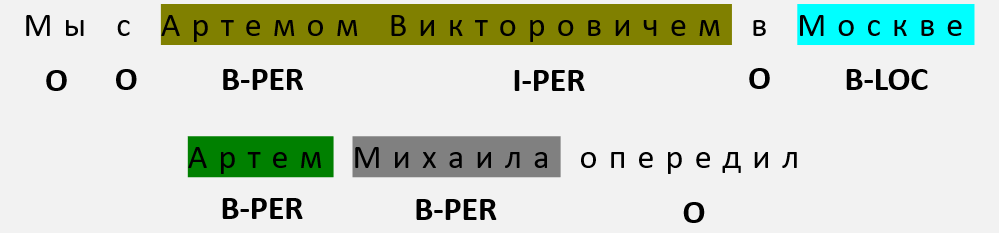

Два основных подхода к решению:

- на основе правил (rule-based approach)
  - использование регулярных выражений (извлечение таких сущностей, как номера телефонов, адреса электронной почты, элементы библиографического списка публикации и т. д.).
  - формулирование правил (первая буква заглавная, остальные – строчные)
- с применением методов машинного и глубокого обучения

**Можно решать с применением RNN и трансформеров**, будет сильный дисбаланс классов, рекомендуется применять балансирующие коэффициенты ([исследование 2023 года](https://elibrary.ru/item.asp?id=56973409)):

$L = - \sum_{k=1}^{s} \alpha_k y_k \ln \hat{y}_k, k = \overline{1,s},$

где $s$ – количество исследуемых классов, $\alpha_k$ – балансирующий коэффициент для $k$-го класса, $y_k$ – метка принадлежности $k$-му классу рассматриваемого объекта ($y_k \in \{0,1\}$), $\hat{y}_k$ – значение $k$-го нейрона выходного слоя сети после применения функции *softmax*.

$\alpha_k = 1 + \sqrt{\frac{n_k^{-1}}{\sum_{j=1}^{s} n_j^{-1}}}, j = \overline{1,s}, k = \overline{1,s}$

где $s$ – количество исследуемых классов, $n_k$ – количество объектов $k$-го класса в обучающей выборке. Значения балансирующих коэффициентов $\alpha_k$ вычисляются до начала обучения классификатора.

**Архитектура BiLSTM-CRF** ([оригинальное исследование 2015 года](https://arxiv.org/abs/1508.01991)) стала стандартом для задач маркировки последовательностей, включая NER.

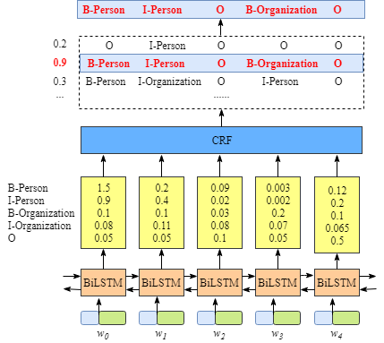

Выходы BiLSTM можно было бы подать на простой полносвязный слой с активацией Softmax для классификации тега каждого токена независимо (TimeDistributed Softmax). Такой подход имеет недостаток: он не учитывает зависимости между соседними тегами.

> Это может привести к **предсказанию синтаксически неверных последовательностей**, например, тег I-PER не может следовать за тегом B-LOC или O

Слой **условного случайного поля** (Conditional Random Field, CRF) решает проблему, моделируя зависимости между тегами и находя наиболее вероятную последовательность тегов для всего предложения целиком.  
Он моделирует условную вероятность последовательности тегов $Y = (y_1, y_2, ..., y_T)$ при заданной последовательности входных векторов (выходов BiLSTM) $X = (x_1, x_2, ..., x_T)$:

$P(Y|X) = \frac{\exp(\text{Score}(X,Y))}{Z(X)} = \frac{\exp\left(\sum_{t=1}^T (E_{t, y_t} + T_{y_{t-1}, y_t})\right)}{\sum_{Y' \in y} \exp\left(\sum_{t=1}^T (E_{t, y'_t} + T_{y'_{t-1}, y'_t})\right)},$

где:

- Score(X,Y) — оценка совместимости последовательности тегов $Y$ с входной последовательностью $X$.
- $E_{t,y_t}$ — эмиссионная оценка (emission score); оценка того, насколько тег $y_t$ подходит для слова в позиции $t$ (поступают напрямую из выходов слоя BiLSTM)
- $T_{y_{t-1},y_t}$ — переходная оценка (transition score); оценка перехода от тега $y_{t-1}$ к тегу $y_t$ (являются обучаемыми параметрами CRF-слоя и формируют матрицу переходов)
- $Z(X)$ — статистическая сумма, нормализующий множитель; это сумма оценок всех возможных последовательностей тегов $Y'$; необходима, чтобы результат был валидным распределением вероятностей (сумма по всем $Y'$ равнялась 1)

Есть предложение: "Михаил Юрьевич уехал в Москву". Хотим, чтобы модель разметила его так: `B-PER, I-PER, O, O, B-LOC`.

CRF обладает **набором правил** (таблица переходных оценок $T_{y_{t-1},y_t}$):

- переход от B-PER к I-PER — очень вероятен (высокая оценка)
- переход от O к B-PER — вполне вероятен (нормальная оценка)
- переход от O к I-PER — почти невозможен (очень низкая оценка)
- переход от B-PER к B-LOC — почти невозможен

CRF берет оценки от BiLSTM и начинает искать лучший путь через предложение, комбинируя оценки токенов (от BiLSTM) и оценки переходов между тегами (свои собственные).

Для вычисления $Z(X)$ при обучении используется алгоритм "Вперед-Назад" (Forward-Backward Algorithm). Идем слева направо по предложению. Вводим величину $\alpha_t(y_j)$ — суммарная оценка всех последовательностей тегов для первых $t$ слов, где $t$-тое слово имеет тег $y_j$.

Начальные оценки вычисляются на основе признаков, связанных только с первым словом ("начинается с большой буквы?").

Далее:

$\alpha_{t}(y_j) = E_{t,y_j} + \log\left(\sum_{i=1}^{k} \exp(\alpha_{t-1}(y_i) + T_{y_i,y_j})\right),$

где:

- $k$ — количество возможных тегов
- $E_{t,y_j}$ — эмиссионная оценка для слова $t$ и тега $y_j$
- $T_{y_i,y_j}$ — переходная оценка от тега $y_i$ к тегу $y_j$

$Z(X) = \sum_{y} \alpha_{n}(y)$

Функция потерь имеет вид:

$L = \log\left(\sum_{Y'} \exp(\text{Score}(X, Y'))\right) - \text{Score}(X, Y_{\text{true}})$

Существуют библиотеки (`keras-contrib`, `sklearn-crfsuite`) с готовой реализацией CRF-слоя.

Также активно применяются трансформеры. Проиллюстрировать хочу в связке с библиотекой `transformers` от [Hugging Face](https://huggingface.co/).

> Это центральная платформа и сообщество в мире современного искусственного интеллекта, особенно в области NLP (GitHub для машинного обучения)

Экосистема Hugging Face состоит из нескольких частей, которые работают вместе:

**Модели**  
Более миллиона предварительно обученных моделей для самых разных задач (перевод, классификация текста, генерация изображений, распознавание речи и др.).

**Наборы данных**  
Более 500 тысяч датасетов для обучения и оценки моделей.

**Пространства**  
Сервис для создания и хостинга демо-версий моделей. Позволяет быстро продемонстрировать работу модели через веб-интерфейс (Gradio, Streamlit)

**Библиотеки**

- `transformers`: для применения языковых моделей
- `datasets`: для загрузки и обработки наборов данных
- `accelerate`: для масштабирования обучения моделей на несколько GPU или TPU
- `evaluate`: для оценки производительности моделей
- `diffusers`: для работы с диффузионными моделями (генерация изображений, аудио и т.д.)
- `gradio`: для быстрого создания UI (интегрирована в Spaces)

```python
from transformers import pipeline

ner_pipeline = pipeline("ner", model="Gherman/bert-base-NER-Russian")

text = "Михаил Гуненков преподает"
entities = ner_pipeline(text)
print(entities)
```

Здесь используется один из [множества пайплайнов](https://huggingface.co/docs/transformers/main_classes/pipelines). Мой [старый ноутбук](../notebooks/Использование моделей с Hugging Face.ipynb) с примерами использования компонентов экосистемы Hugging Face.

Для решения задачи NER и множества других используется фреймворк [Spacy](https://spacy.io/). Есть [три модели для русского языка](https://spacy.io/models/ru) (привет Александру Кукушкину). Особенность фреймворка — собственная единая архитектура моделей, напоминающая конвейер.

Идея: мы прогоняем текст через последовательность компонентов модели. Результатом обработки является объект `Doc`, который содержит в себе всю извлеченную из текста информацию (отдельные токены, их леммы, информацию о частях речи и синтаксической роли каждого токена, именованные сущности и т. д.).

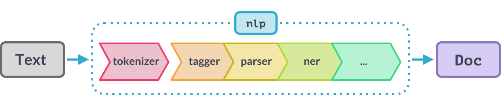

Объект `Doc` очень похож на обычные списки (массивы). Обращаясь по индексу (к конкретному слову) мы извлекаем объект `Token`. Обращаясь по нескольким индексам (с помощью среза) мы получаем объект `Span` (несколько токенов).

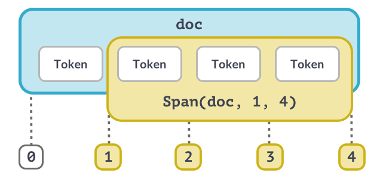

Каждый токен содержит в себе ссылку на соответствующий ему объект в словаре (в объекте `Vocab`). Каждый объект в словаре содержит хэш, по которому модель находит лемму для токена.

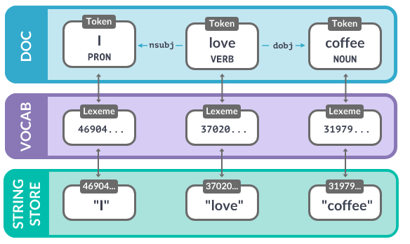

Мой [старый ноутбук](../notebooks/Spacy.ipynb) с интересными примерами использования Spacy.

## Семантический поиск

Задача нахождения текстов (документов, предложений), наиболее близких по смыслу к заданному запросу, в большой коллекции. Основой для поиска служат векторные представления предложений (семантика в виде точек в многомерном пространстве). Все сводится к тому, чтобы найти в этом пространстве векторы, ближайшие к вектору запроса.

> Стандартный подход к использованию BERT для задач сравнения пар предложений оказался неэффективным для поиска

Для сравнения двух предложений их объединяди в одну входную последовательность через специальный токен `SEP` и подавали на вход модели. Модель обрабатывала эту объединенную последовательность и на выходе выдавала оценку сходства. Такой подход позволяет токенам из обоих предложений взаимодействовать друг с другом на всех слоях трансформера. Это называется Cross-Encoder.

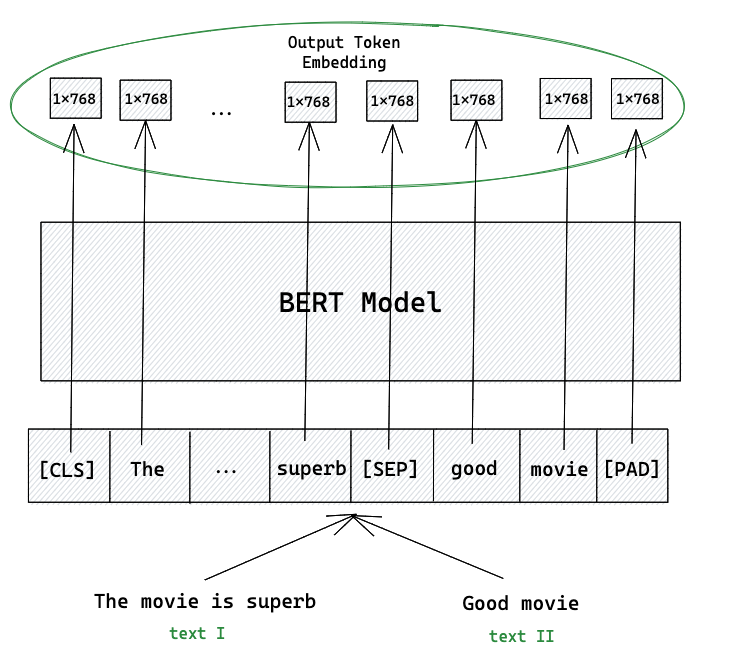

Чтобы найти наиболее похожее предложение в коллекции из $n=10000$ предложений, потребуется выполнить $n (n-1)/2 \approx 50$ миллионов прогонов модели через BERT.

Модель **Sentence-BERT** (SBERT) решает эту проблему, изменяя архитектуру и процесс обучения. SBERT использует архитектуру Bi-Encoder, основанную на сиамской сети (siamese network). Два предложения обрабатываются независимо друг от друга одной и той же предобученной моделью BERT (веса которой связаны). [Оригинальное исследование 2019 года](https://arxiv.org/abs/1908.10084).

Схема:

- каждое предложение по отдельности подается на вход BERT
- на выходе BERT получаем последовательность векторов для каждого токена
- применяется операция пулинга (pooling), чтобы преобразовать эту последовательность переменной длины в один вектор фиксированного размера (эмбеддинг предложения)
- сходство между двумя предложениями вычисляется уже после получения их эмбеддингов, обычно с помощью косинусного расстояния

> Можно заранее вычислить и сохранить эмбеддинги для всех документов в коллекции. Когда поступает запрос, нужно вычислить эмбеддинг только для него, а затем выполнить эффективный **поиск ближайших соседей** в базе векторов

> "Сиамская сеть" — это название подхода, при котором один и тот же кодировщик независимо обрабатывает различные тексты

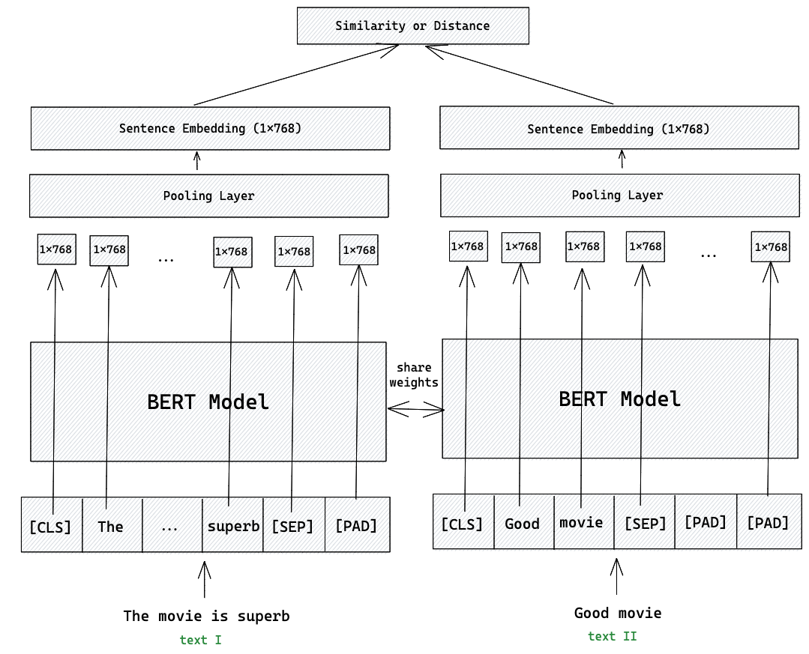

Стратегии пуллинга:

- CLS-пулинг: использование векторного представления специального токена `CLS`, который добавляется в начало каждой последовательности
- Mean-пулинг: усреднение векторов выходных токенов (часто показывает наилучшие результаты)
- Max-пулинг: взятие максимальных значений по каждой размерности векторов выходных токенов

Несмотря на очевидность идеи в оригинальном исследовании отмечается, что простое взятие предварительно обученной модели BERT и применение к ней пулинга дает плохие по качеству эмбеддинги отдельных предложений. Это происходит потому, что BERT изначально не обучался для создания семантически осмысленного векторного пространства для сравнения предложений. Необходимо использовать дообучение со специальными функциями потерь.

**Contrastive Loss**  
Используется для наборов данных, где есть пары предложений с меткой "похожи" или "не похожи". Для положительной пары она минимизирует расстояние между их эмбеддингами. Для отрицательной стремится сделать расстояние больше некоторого заданного порога (margin, $m$). Если расстояние уже больше порога, штраф не применяется.

Для пары эмбеддингов $u$ и $v$ и метки $y \in \{0, 1\}$ (где $y = 0$ для похожих, $y = 1$ для непохожих):

$L_{\text{Contrastive}} = (1 - y) \cdot \frac{1}{2}D^2 + y \cdot \frac{1}{2}\max(0, m - D)^2,$

где $D = \|u - v\|_2$ — евклидово расстояние.

**Triplet Loss**  
Работает с тройками примеров: якорь (anchor), положительный пример (positive) и отрицательный пример (negative). Якорь и положительный пример семантически близки, а якорь и отрицательный — далеки. Цель функции потерь — сделать так, чтобы расстояние от якоря до положительного примера было меньше, чем расстояние от якоря до отрицательного, как минимум на величину порога (margin, $\alpha$).

Формула для эмбеддингов якоря ($a$), положительного ($p$) и отрицательного ($n$) примеров:

$L_{\text{Triplet}} = \max(0, D(a, p)^2 - D(a, n)^2 + \alpha),$

где:

- $D(a, p)$ — евклидово расстояние между эмбеддингами якоря и положительного примера
- $D(a, n)$ — евклидово расстояние между эмбеддингами якоря и отрицательного примера
- $\alpha$ — требуемый порог (margin)

**Архитектура "Retrieve & Re-Rank"**

**Этап 1: Retrieve**  
Используется быстрая Bi-Encoder модель (SBERT). Для заданного запроса она сканирует всю коллекцию документов и отбирает список потенциально релевантных кандидатов (100, 1000).

**Этап 2: Re-Rank**  
Используется более точная Cross-Encoder модель. Она применяется только к небольшому набору кандидатов, полученному на первом этапе. Cross-Encoder попарно сравнивает запрос с каждым из кандидатов и выдает точную оценку релевантности. Формируется финальный, отсортированный список результатов.

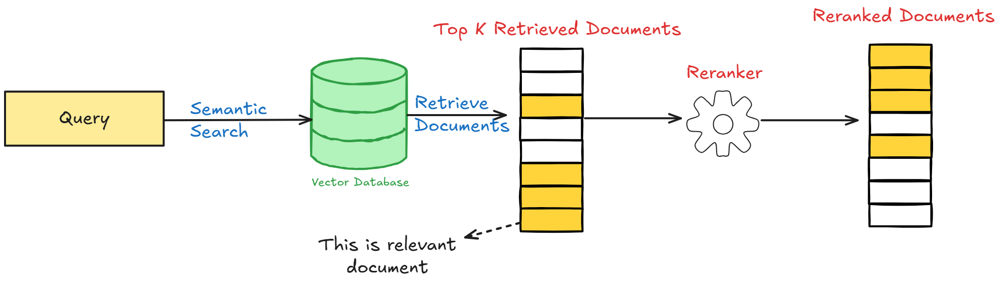

Широко применяется библиотека `sentence-transformers`, созданная авторами SBERT.

```python
from sentence_transformers import SentenceTransformer, util

model = SentenceTransformer('all-MiniLM-L6-v2')

sentences = ...

embeddings = model.encode(sentences)

cosine_scores = util.cos_sim(embeddings, embeddings[1:])
print(cosine_scores)
```

Библиотека поддерживает работу с множеством предварительно обученных Cross-Encoder и Bi-Encoder. Интегрирована с Hugging Face Hub.

> Переход от Cross-Encoder к Bi-Encoder для задач поиска — важный сдвиг в NLP: от представления текста как последовательности токенов к представлению текста как точки в векторном пространстве. Это дало начало развитию векторных БД (Faiss, Chroma и др.) и всему современному RAG

## Задачи понимания и генерации текста

### Суммаризация

Процесс создания краткого, связного и точного изложения ключевой информации из одного или нескольких исходных документов. Два основных подхода:

**Экстрактивная суммаризация**  
Резюме создается путем выбора и объединения наиболее важных предложений или фраз непосредственно из исходного текста. Метод гарантирует фактологическую точность, но страдает от плохой связности.

**Абстрактивная суммаризация**  
Резюме генерируется своими словами. Модель улавливает основные идеи исходного текста и пересказывает их. Этот подход ближе к тому, как резюмируют люди. Это позволяет создавать более гладкие и лаконичные тексты. Но в то же время появляется риск "галлюцинаций".

**Bidirectional and Auto-Regressive Transformer (BART)** — предварительно обученная Seq2Seq-модель, разработанная для задач генерации текста. Ее архитектура объединяет BERT и GPT (двунаправленный кодировщик и авторегрессионный декодировщик). [Оригинальное исследование 2020 года](https://aclanthology.org/2020.acl-main.703/).

Инновация в стратегии предобучения — denoising autoencoder. В процессе предобучения модель учится восстанавливать исходный текст из его искусственно зашумленной версии. Используются различные "функции зашумления" (noising functions):

- Token Masking: случайные токены заменяются на специальный токен `MASK`, как в BERT
- Token Deletion: случайные токены удаляются из последовательности
- Sentence Permutation: предложения в документе перемешиваются в случайном порядке

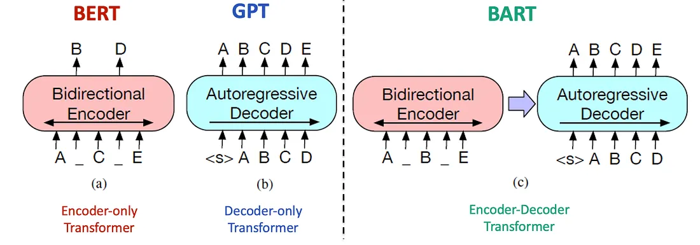

**Text-to-Text Transfer Transformer (T5)** — еще более универсальный подход. Основная идея: свести любую задачу NLP к формату "текст-в-текст". Вместо того чтобы создавать разные архитектуры для разных задач (классификация, регрессия и т. д.), T5 использует одну и ту же модель для всего. [Оригинальное исследование 2021 года](https://arxiv.org/abs/2102.02017).

Задача, которую нужно решить, указывается в виде текстового префикса, добавляемого к входным данным:

- `translate` English to Russian: That is good. -> Респект, коллега.
- `summarize`: [длинный текст документа] -> [краткое резюме]
- `classify news`: Правительство объявило о новых экономических реформах, направленных на поддержку малого бизнеса. -> positive

Для суммаризации стандартной метрикой является **Recall-Oriented Understudy for Gisting Evaluation** (ROUGE), которая сравнивает сгенерированное резюме с эталонным резюме на основе лексического совпадения. [Представлена в статье 2019 года](https://aclanthology.org/U19-1008.pdf).

**ROUGE-N**

Recall:

$\text{ROUGE-N}_{\text{recall}} = \frac{\text{Количество общих n-грамм}}{\text{Общее количество n-грамм в эталоне}}$

Precision:

$\text{ROUGE-N}_{\text{precision}} = \frac{\text{Количество общих n-грамм}}{\text{Общее количество n-грамм в сгенерированном резюме}}$

Гармоническое среднее точности и полноты (F1):

$\text{ROUGE-N}_{\text{F1}} = 2 \cdot \frac{\text{Precision} \cdot \text{Recall}}{\text{Precision} + \text{Recall}}$

**ROUGE-L**

Метрика на основе наибольшей общей подпоследовательности (Longest Common Subsequence, LCS).

Recall:

$R_{lcs} = \frac{\text{LCS}(X, Y)}{m}$

Precision:

$P_{lcs} = \frac{\text{LCS}(X, Y)}{n}$

F1:

$F_{lcs} = \frac{(1 + \beta^2) R_{lcs} P_{lcs}}{R_{lcs} + \beta^2 P_{lcs}},$

где:

- `X` — эталонное резюме
- `Y` — сгенерированное резюме
- `LCS(X, Y)` — длина наибольшей общей подпоследовательности
- `m` — длина эталонного резюме (количество токенов)
- `n` — длина сгенерированного резюме (количество токенов)
- `β` — коэффициент, придающий больший вес полноте, чем точности

> ROUGE не оценивает связность текста, грамматическую правильность или фактологическую точность; проверяется только лексическое совпадение с эталоном

### Вопросно-ответные системы и стратегии декодирования

Предназначены для предоставления ответов на вопросы, которые сформулированы на естественном языке. Два типа:

**Экстрактивная QA (Extractive QA)**  
Получают на вход вопрос и контекст (абзац из Википедии) и должны найти ответ на вопрос в виде непрерывного фрагмента текста (span) непосредственно из этого контекста. Можно дообучить модель типа BERT. К выходам трансформера добавляют два слоя — два классификатора. Один предсказывает вероятность того, что данный токен является началом ответа, а другой — концом ответа.

**Абстрактивная / Генеративная QA (Abstractive / Generative QA)**  
Модель генерирует ответ, основываясь на предоставленном контексте. Задача решается с помощью Seq2Seq-моделей.

> Результат работы генеративной модели определяется не только ее архитектурой и весами, но и стратегией декодирования: алгоритмом, который на каждом шаге выбирает следующий токен из распределения вероятностей, предсказанного моделью

**Стратегии генерации токенов:**

**Greedy Search (Жадный поиск)**  
На каждом шаге генерации выбирается один токен с наивысшей вероятностью. Часто приводит к неоптимальным результатам (повторяющиеся фразы).

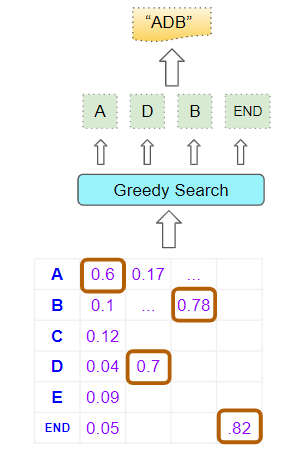

**Beam Search (Лучевой поиск)**

Вместо одного наиболее вероятного токена, на каждом шаге отслеживается $k$ наиболее вероятных частичных последовательностей (гипотез, "лучей"). Параметр $k$ называется шириной луча (beam width). На следующем шаге для каждой из $k$ гипотез генерируются все возможные продолжения, и из них снова выбираются $k$ гипотез с самой высокой совокупной вероятностью (вероятности перемножаются).

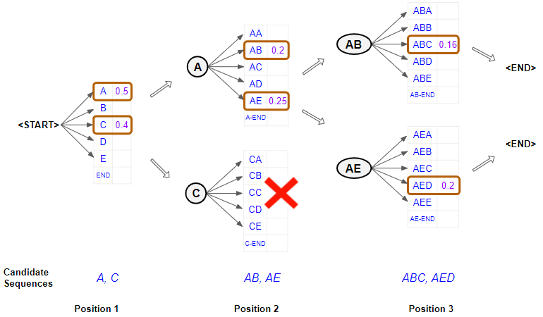

**Пример:**

Сгенерируем предложение, начиная со слова "The". Задача — найти наиболее вероятную последовательность из 3 слов. Ширину луча ($k$) возьмём равной 2. Всегда будем держать в уме 2 лучших варианта. Модель начинает со слова "The" и предсказывает слово, присваивая каждому варианту вероятность:

- The cat: 0.5
- The dog: 0.3
- The car: 0.1
- The house: 0.05

**Получаем:**

- Кандидат 1: The cat (вероятность 0.5)
- Кандидат 2: The dog (вероятность 0.3)

**Делаем предсказание для каждого из двух кандидатов:**

Для "The cat":

- The cat sits: 0.6 (общая вероятность: 0.5 \* 0.6 = 0.30)
- The cat runs: 0.3 (общая вероятность: 0.5 \* 0.3 = 0.15)

Для "The dog":

- The dog barks: 0.5 (общая вероятность: 0.3 \* 0.5 = 0.15)
- The dog sleeps: 0.4 (общая вероятность: 0.3 \* 0.4 = 0.12)

**Итого:**

- Новый Кандидат 1: The cat sits (вероятность 0.30)
- Новый Кандидат 2: The cat runs (вероятность 0.15)

**Top-K Sampling (Сэмплирование по K лучшим)**  
На каждом шаге генерации отбирается $K$ токенов с самыми высокими вероятностями. Далее вероятности этих $K$ токенов перенормируются, следующий токен выбирается случайным образом (сэмплируется) из этого ограниченного набора.

**Top-P (Nucleus) Sampling (Сэмплирование по ядру)**  
Вместо фиксированного числа $K$ выбирается наименьший набор токенов, чья суммарная вероятность превышает порог $p$. Этот набор называется "ядром" (nucleus). Далее сэмплирование происходит только из токенов, попавших в это ядро.

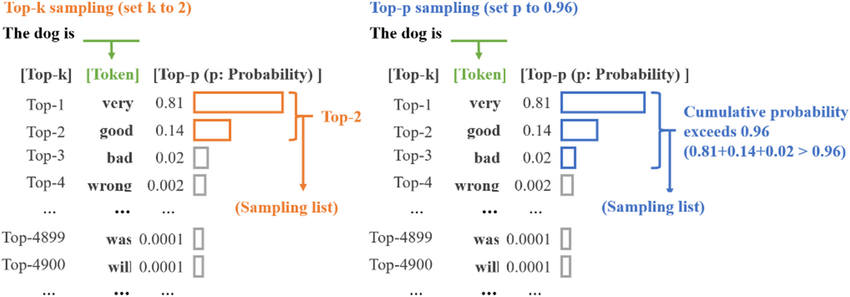

Пример с `transformers`:

```python
from transformers import AutoModelForCausalLM, AutoTokenizer

model_name = "gpt2"
tokenizer = AutoTokenizer.from_pretrained(model_name)
model = AutoModelForCausalLM.from_pretrained(model_name)
input_ids = tokenizer.encode("I'am in the beginning of", return_tensors='pt')

# Beam Search
beam_output = model.generate(
    input_ids,
    max_length=50,
    num_beams=5,
    early_stopping=True
)
print("Beam Search:", tokenizer.decode(beam_output, skip_special_tokens=True))

# Top-K и Top-P Sampling
sampling_output = model.generate(
    input_ids,
    do_sample=True, 
    max_length=50,
    top_k=50,
    top_p=0.95
)
print("Top-K/Top-P Sampling:", tokenizer.decode(sampling_output, skip_special_tokens=True))
```
