<!-- source: https://wiki.pmifi.ru/disciplines/nlp/lectures/speech -->
<!-- updated: 2025-12-26T20:25:51.595Z -->
<!-- author: Михаил Гуненков -->

# Основы распознавания и синтеза речи

## Цифровая обработка аудиоданных

> В отличие от текста, который дискретен, звук представляет собой **непрерывный во времени сигнал**

**Звук** — распространение волн сжатия и разрежения в упругой среде (обычно в воздухе). Микрофон преобразует эти колебания давления в непрерывный электрический сигнал напряжения $x(t)$.

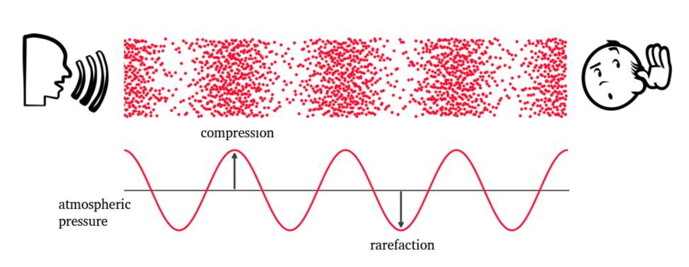

Звуковая волна характеризуется:

- частотой ($f=\frac{1}{T}$ ,$T$ - период);
- амплитудой ($A$);
- фазой ($ϕ$, актуально когда звуковые волны накладываются друг на друга).

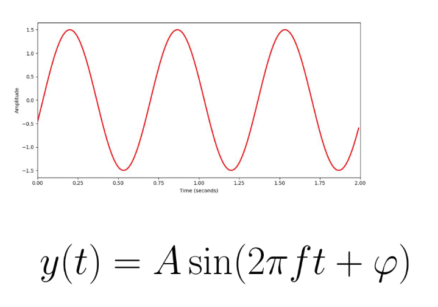

Для обработки на компьютерах аналоговый сигнал подвергается **импульсно-кодовой модуляции** (Pulse Code Modulation, PCM), которая состоит из двух ключевых этапов: дискретизации по времени и квантования по амплитуде.

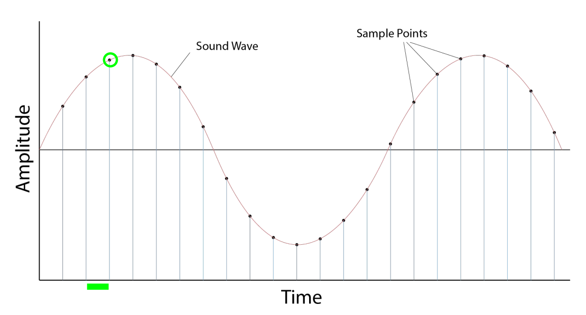

Дискретизация подразумевает измерение амплитуды сигнала через равные промежутки времени $T_s$. Частота дискретизации $f_s = 1/T_s$ определяет количество замеров (сэмплов) в секунду.

Фундаментальным ограничением здесь выступает **Теорема Котельникова (Найквиста-Шеннона)**. Для точного восстановления непрерывного сигнала с ограниченным спектром из его дискретных отсчетов необходимо, чтобы частота дискретизации превышала удвоенную максимальную частоту спектра сигнала $f_{max}$:

$f_s \ge 2 f_{max}$

Человеческий слух воспринимает частоты в диапазоне от 20 Гц до 20 кГц. Стандарт CD-Audio (44.1 кГц) выбран для покрытия всего слышимого диапазона ($f_{max} \approx 22.05$ кГц). При этом в задачах распознавания речи (ASR) часто используется частота 16 кГц: основная фонетическая информация сосредоточена в диапазоне до 8 кГц. Использование 16 кГц снижает размерность входных данных и вычислительную нагрузку без существенной потери разборчивости речи.

> Аудиотрек может интерпретироваться как временной ряд. А временные ряды - это последовательности. Значит, мы **будем иметь дело с обработкой последовательностей**

Каждый отсчет амплитуды должен быть представлен конечным набором бит. Квантование — нелинейное отображение непрерывного множества значений амплитуды на дискретное множество уровней. Если используется $N$ бит, диапазон амплитуд разбивается на $2^N$ уровней. Ошибка округления порождает шум квантования.

Важной метрикой является Отношение сигнала к шуму квантования (SQNR - Signal-to-Quantization-Noise Ratio). Для синусоидального сигнала полной амплитуды SQNR выражается формулой:

$\text{SQNR (dB)} \approx 6.02 N + 1.76,$

где $N$ — битовая глубина.

> Каждый 1 дополнительный бит добавляет примерно 6 дБ чистоты (полезного сигнала) по сравнению с шумом

- 16 бит: $SQNR \approx 98$ дБ (стандарт для качественной записи)
- 8 бит: $SQNR \approx 50$ дБ (приемлемо для телефонии, но слышен явный шум)

В системах глубокого обучения данные обычно нормализуются в диапазон $[-1.0, 1.0]$ и представляются в формате с плавающей точкой (float32), однако исходная природа целочисленного квантования (int16 в формате WAV) определяет предельный динамический диапазон сигнала.

Речевой сигнал является нестационарным: его спектральные характеристики быстро меняются во времени по мере смены фонем. Применение преобразования Фурье (DFT) ко всему сигналу целиком уничтожило бы информацию о времени. Спектр предложения покажет, какие частоты в нем присутствовали, но не когда они звучали.

Решением является **предположение о квазистационарности речи на коротких промежутках времени** (20–40 мс). В пределах такого окна слух человека не успевает существенно изменить конфигурацию и сигнал можно считать стационарным.

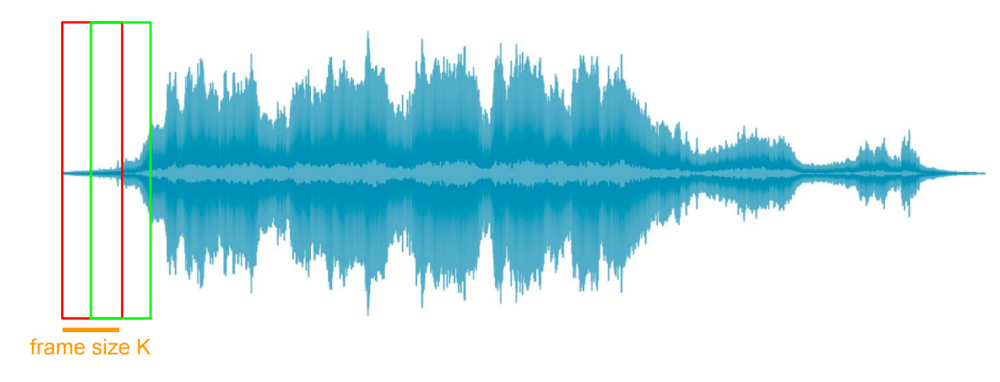

> Предполагается, что все фреймы содержат **одинаковое количество точек дискретизации**. Если последний фрейм получается короче остальных - применяется паддинг (как правило, происходит заполнение нулями).

## Извлечение признаков

Кратковременное преобразование Фурье (Short-Time Fourier Transform, STFT) является фундаментом обработки аудио. Сигнал разбивается на перекрывающиеся сегменты (фреймы), и к каждому применяется [дискретное преобразование Фурье](https://habr.com/ru/companies/otus/articles/449996/) (Discrete Fourier Transform, DFT).

STFT для сигнала $x[m]$ определяется следующим образом:

$X[n, k] = \sum_{m=0}^{L-1} x[m + nH] \cdot w[m] \cdot e^{-i \frac{2\pi k m}{N_{FFT}}}$

Здесь:

- $n$ — индекс временного фрейма
- $k$ — индекс частотного бина ($k = 0, \dots, N_{FFT}/2$)
- $x[m + nH]$ — сегмент сигнала, сдвинутый на шаг $H$ (hop length), обычно $H$ составляет 10–15 мс (160 сэмплов при 16 кГц)
- $w[m]$ — оконная функция длины $L$ (окно Ханна или Хэмминга)
- $N_{FFT}$ — размерность FFT (как правило, степень двойки: 512, 1024).

> При заданных параметрах результатом преобразования **является матрица** размерности `(frequency bins, frames)`. В ячейках матрицы - интенсивность данной полосы в данном фрейме

Результат $X[n, k]$ — комплексное число. Модуль характеризует громкость. Квадрат модуля называется спектрограммой мощности:

$S[n, k] = |X[n, k]|^2$

Возведение модуля в квадрат переводит физическую величину из амплитуды в энергию.

> Это представление можно интерпретировать как **двумерное изображение**, где интенсивность пикселя отражает энергию

Восприятие высоты звука человеком нелинейно. Различие между 100 Гц и 200 Гц воспринимается как значительное, тогда как различие между 10000 Гц и 10100 Гц практически неразличимо. **Шкала мелов** (Mel Scale, от Melody) аппроксимирует данную психоакустическую особенность слуха.

Перевод частоты $f$ (Гц) в мелы $m$:

$m = 2595 \cdot \log_{10}\left(1 + \frac{f}{700}\right)$

Обратное преобразование:

$f = 700 \cdot \left(10^{m/2595} - 1\right)$

Для получения признаков, подаваемых на вход ML-моделям, спектрограмма мощности пропускается через набор треугольных фильтров, распределенных равномерно по шкале мелов. Это снижает размерность по оси частот (с 513 бинов до 80 мел-каналов) и учитывает особенности восприятия.

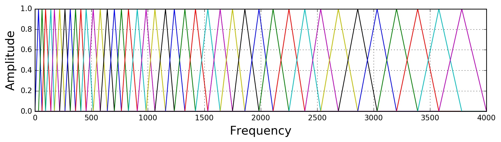

> Треугольники должны быть равнобедренными и одинаковой ширины

Берем диапазон частот (допустим, от 0 Гц до 8000 Гц), переводим границы в мелы. Разбиваем диапазон на $N$ равных отрезков ($N$ — количество фильтров). Если нужно 40 фильтров, потребуется 42 точки (границы + пики). Точка $m[i]$ — центр $i$-го треугольника, а также вершина для соседей.

Переводим равномерные точки обратно в Герцы (после обратного перевода точки перестанут быть равномерными). Округляем частоты до ближайшего номера бина $f(i)$:

$bin(i) = \lfloor \frac{N_{FFT} + 1}{SampleRate} \cdot frequency(i) \rfloor$

Теперь у нас есть список координат вершин треугольников в номерах бинов. Для каждого фильтра $m$ вычисляем вес для каждого частотного бина $k$.

Треугольник задается тремя точками:

- $f[m-1]$ (левый край, вес 0)
- $f[m]$ (пик, вес 1)
- $f[m+1]$ (правый край, вес 0)

Формула веса $w[k]$:

$H_m(k) =
\begin{cases}
0, & k < f[m-1] \\
\frac{k - f[m-1]}{f[m] - f[m-1]}, & f[m-1] \le k \le f[m] \quad (\text{подъем}) \\
\frac{f[m+1] - k}{f[m+1] - f[m]}, & f[m] < k \le f[m+1] \quad (\text{спуск}) \\
0, & k > f[m+1]
\end{cases}$

> Если бин $k$ находится на пике ($f[m]$), то вес равен 1.0. Если бин находится ровно посередине между краем и пиком, то вес равен 0.5. Если бин за пределами треугольника, то вес 0.

**Формула мел-спектрограммы:**

$Mel(m) = \sum_{k=0}^{N_{bins}-1} S[k] \cdot H_m(k)$

Здесь $S$ — спектрограмма мощности.

> Если фильтр широкий, то суммируем энергию сотни бинов в одно число. Если фильтр узкий, то берем энергию всего пары бинов.

В некоторых реализациях (в librosa) треугольники дополнительно нормализуют по площади. Широкие треугольники захватывают больше бинов чем узкие. Если оставить пик всегда равным 1.0, то в высокочастотных фильтрах сумма энергии будет огромной (просуммировали больше слагаемых). Чтобы энергия была согласована, высоту широких треугольников делают меньше (они становятся низкими и широкими), а узких — больше.

$H_m(k)_{norm} = H_m(k) \cdot \frac{2}{f[m+1] - f[m-1]}$

**Log-Mel Spectrogram** (логарифмическая мел-спектрограмма) является стандартом входных данных для современных моделей (Tacotron 2, Whisper и др.).

$LogMel[n, m] = \log(Mel[n, m] + \epsilon)$

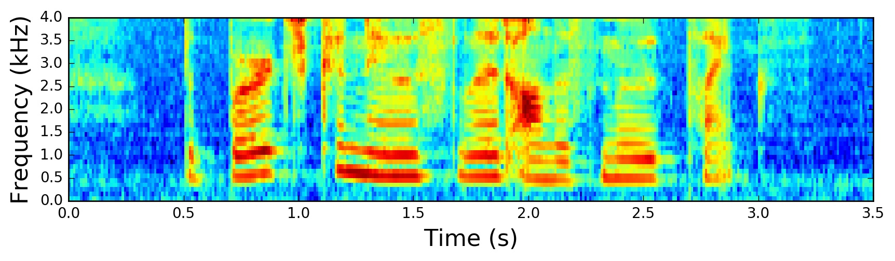

Здесь $\epsilon$ необходим, чтобы не получить $-\infty$ при логарифме нуля.

Извлечение и визуализация мел-спектрограммы:

```python
import librosa
import librosa.display
import numpy as np
import matplotlib.pyplot as plt

def extract_and_plot_features(audio_path):
    SR = 16000
    N_FFT = 400
    HOP_LENGTH = 160
    N_MELS = 80

    y, _ = librosa.load(audio_path, sr=SR)
    
    mel_spec = librosa.feature.melspectrogram(
        y=y, 
        sr=SR, 
        n_fft=N_FFT, 
        hop_length=HOP_LENGTH, 
        n_mels=N_MELS,
        power=2.0
    )
    
    log_mel_spec = librosa.power_to_db(mel_spec, ref=np.max)

    plt.figure(figsize=(12, 4))
    librosa.display.specshow(
        log_mel_spec, 
        sr=SR, 
        hop_length=HOP_LENGTH, 
        x_axis='time', 
        y_axis='mel',
    )
    plt.colorbar(format='%+2.0f dB')
    plt.title('Log-Mel Spectrogram (80 бинов)')
    plt.tight_layout()
    plt.show()

filename = librosa.ex('trumpet')
extract_and_plot_features(filename)
```

Отображение плеера в IPython:

```python
Audio(data=y, rate=sr)
```

Очень часто студенты используют другой тип входных данных — MFCC.

**Мел-частотные кепстральные коэффициенты** (MFCC — Mel-frequency cepstral coefficients) — максимально сжатая и очищенная версия мел-спектрограммы.

Голос состоит из двух компонентов:

**Источник (Source)**

Голосовые связки вибрируют и создают жужжание. Это определяет высоту голоса.

**Фильтр (Filter)**

Горло, язык, зубы и губы вырезают из жужжания конкретные частоты, превращая его в звуки «А», «О», «Ш». Это определяет смысл.

**Цель MFCC** — отделить смысл от индивидуальности голоса, чтобы компьютер понимал слова, независимо от того, кто их говорит.

> MFCC получаются, если к Log-Mel спектрограмме применить дискретное косинусное преобразование (DCT)

Пусть есть вектор логарифмических энергий с мелов (Log-Mel) для одного кадра. Обозначим его $S[m]$, где $m$ — номер мел-фильтра (от $0$ до $M-1$). Тогда $k$-й кепстральный коэффициент $c[k]$ вычисляется так:

$c[k] = \sum_{m=0}^{M-1} S[m] \cdot \cos\left( \frac{\pi k (m + 0.5)}{M} \right)$

> Обычно $k$ меняется от 0 до 12 (итого 13 коэффициентов)

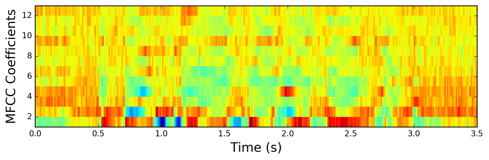

> Низкие значения $k$ (0–12) описывают общую форму спектра. Это звуки речи (форманты). Высокие $k$ (20–40) описывают быструю шум и индивидуальные особенности связок.

Сверточные нейронные сети умеют самостоятельно находить зависимости между соседними пикселями. Удаляя высокие частоты через MFCC, можем выкинуть что-то важное. В современных моделях глубокого обучения **MFCC почти не используют**. При этом эти коэффициенты используются при обучении традиционных моделей ML (ансамбли деревьев, SVM).

## Автоматическое распознавание речи

Задача Speech-to-Text (Automatic Speech Recognition, ASR) формулируется как поиск наиболее вероятной последовательности символов или слов $Y$ для заданной входной последовательности акустических признаков $X$:

$\hat{Y} = \arg\max_Y P(Y|X)$

**Фундаментальная сложность ASR** заключается в проблеме выравнивания (alignment). Длина входной последовательности $T$ (количество фреймов спектрограммы) всегда значительно больше длины выходной последовательности $L$ (количество букв). Слово "cat" может длиться 500 мс (50 фреймов по 10 мс), но состоит всего из 3 букв.

> Мы не знаем, какой фрейм соответствует какой букве.

[Коннекционистская временная классификация](https://www.semanticscholar.org/paper/Connectionist-Temporal-Classification-Graves/84ed475714183a93906baade15c69216e77fa837) (Connectionist Temporal Classification, CTC, 2006) позволяет обучать нейронные сети предсказывать последовательность символов без явной разметки границ фонем.

CTC вводит специальный служебный символ blank, который обозначается как $\epsilon$ или -. Для каждого временного шага $t$ нейросеть предсказывает распределение вероятностей по расширенному словарю $V' = V \cup \{\epsilon\}$.

Пусть сеть выдает последовательность $\pi = (\pi_1, \dots, \pi_T)$, где $\pi_t \in V'$. Определим функцию отображения $\mathcal{B}(\pi)$, которая работает в два этапа:

- объединение подряд идущих одинаковых символов
- удаление символов $\epsilon$.

Примеры:

- $\mathcal{B}(c, c, a, a, a, t, t) = (c, a, t)$
- $\mathcal{B}(c, c, \epsilon, a, a, t) = (c, a, t)$
- $\mathcal{B}(c, c, \epsilon, c, c, a, t) = (c, c, a, t)$

> Наличие $\epsilon$ позволяет разделить две одинаковые буквы (например, в слове "cooperation")

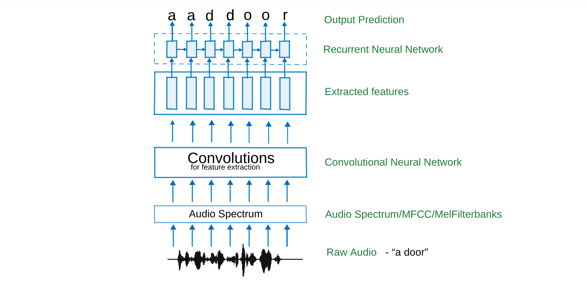

Вероятность целевой последовательности $Y$ определяется как сумма вероятностей всех возможных путей $\pi$, которые сводятся к $Y$ после применения $\mathcal{B}$:

$P(Y|X) = \sum_{\pi \in \mathcal{B}^{-1}(Y)} P(\pi|X)$

Вероятность конкретного пути:

$P(\pi|X) = \prod_{t=1}^T y_{\pi_t}^t$

Функция потерь CTC (CTC Loss) — отрицательный логарифм правдоподобия:

$\mathcal{L}_{CTC} = - \log P(Y|X)$

> Прямое суммирование по всем путям невозможно, так как их количество растет экспоненциально с $T$. Используется алгоритм Forward-Backward.

Есть сетка:

- ось X — временные шаги ($T$) от аудио
- ось Y — расширенная целевая последовательность ($S$)

Движение по сетке возможно только слева-направо (по времени) и только вниз (по последовательности символов), с определенными правилами переходов.

Переменная $\alpha(s, t)$ представляет собой вероятность того, что часть последовательности от начала до символа $s$ была распознана к моменту времени $t$. Можем начать только с первого символа (- или первый значимый символ) в момент $t=0$.

Чтобы вычислить $\alpha(s, t)$ суммируем вероятности прихода в это состояние из предыдущих допустимых состояний на шаге $t-1$:

- мы могли остаться в том же символе ($s$)
- мы могли прийти из предыдущего символа ($s-1$)
- если текущий символ не $\epsilon$ и не совпадает с символом $s-2$, то мы могли перепрыгнуть через blank, придя сразу из $s-2$

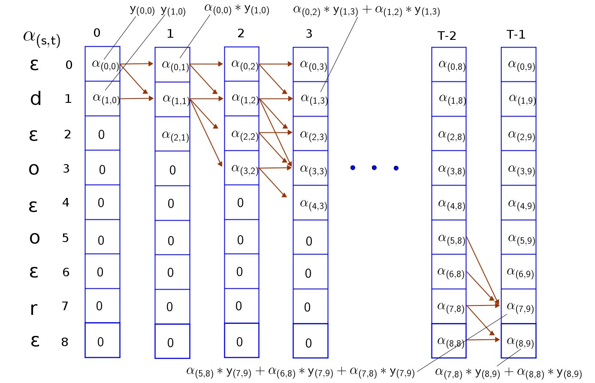

Переменная $\beta(s, t)$ делает то же самое, но в обратном направлении. Она показывает вероятность завершения оставшейся части последовательности (от $s$ до конца), начиная с момента времени $t$. Начинаем с конца времени $T-1$ и последних возможных символов последовательности. Двигаемся назад во времени (от $T-2$ к $0$), вычисляя вероятность успешного завершения пути из текущей точки. Правила переходов аналогичны.

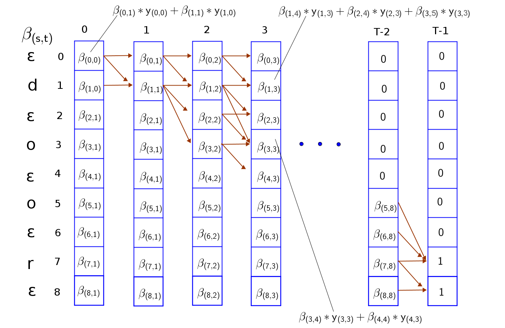

Имея значения $\alpha$ и $\beta$ для каждой точки $(s, t)$, можем вычислить полную вероятность прохождения верного пути через этот конкретный символ $s$ в момент $t$:

$\gamma(s, t) = \alpha(s, t) \cdot \beta(s, t)$

> Суммирование этих вероятностей позволяет получить общую вероятность пути для данного входа

Почитать про CTC можно [здесь](https://sid2697.github.io/Blog_Sid/algorithm/2019/10/19/CTC-Loss.html) и [здесь](https://ogunlao.github.io/blog/2020/07/17/breaking-down-ctc-loss.html). В PyTorch присутствует абстракция `nn.CTCLoss`.

> Для получения финального текста из выходов сети могут использоваться **уже знакомые нам стратегии декодирования** (жадный поиск, лучевой поиск, семплирование)

### Wav2Vec

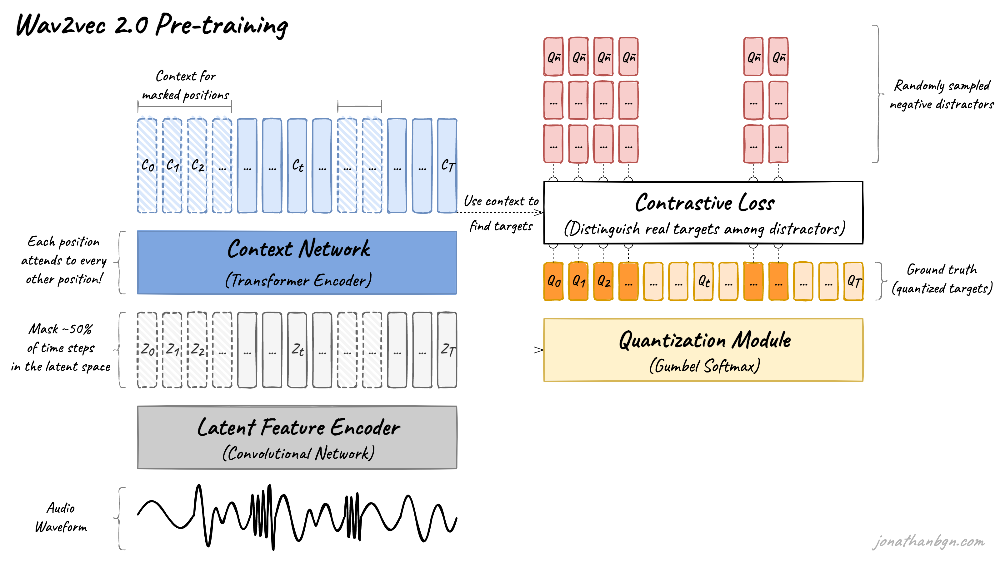

[Оригинальное исследование 2020 г.](https://proceedings.neurips.cc/paper/2020/file/92d1e1eb1cd6f9fba3227870bb6d7f07-Paper.pdf)

**Audio Waveform**

На вход подается сырой звук (НЕ спектрограмма).

**Latent Feature Encoder**

Сверточная сеть. Превращает волну в последовательность латентных векторов $Z_0, Z_1, \dots, Z_T$.

**Masking**

Примерно 50% временных шагов $Z$ скрываются (заменяются на специальный токен).

**Context Network**

Кодировщик трансформера. Анализирует всю последовательность. На выходе получаются контекстные вектора $C_0, C_1, \dots, C_T$. Для замаскированных позиций вектор $C$ — попытка модели угадать, что там было, основываясь на окружающих звуках.

**Quantization Module**

Сюда поступают оригинальные, немаскированные вектора $Z$. Используя метод [Gumbel Softmax](https://sassafras13.github.io/GumbelSoftmax/), непрерывные вектора превращаются в дискретные значения $Q_0, Q_1, \dots, Q_T$.

Задача модели — для маскированного шага $t$ предсказать правильный квантованный вектор $q_t$ среди набора дистракторов (негативных примеров, взятых из других частей аудио):

$L_m = -\log \frac{\exp(\text{sim}(c_t, q_t)/\kappa)}{\sum_{\tilde{q} \in Q_t} \exp(\text{sim}(c_t, \tilde{q})/\kappa)}$

Здесь $\text{sim}$ — косинусная близость, $\kappa$ — температура.

> Мне очень нравится термин "акустический токен"

> При дообучении используется только слой **Context Network** (функция потерь CTC Loss). Это существенно уменьшает необходимый объем текстовых данных для дообучения.

### Whisper

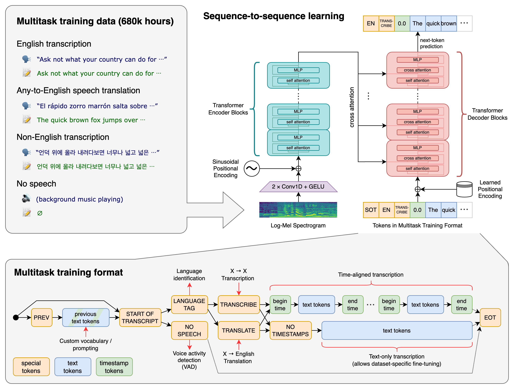

[Оригинальное исследование 2022 г.](https://arxiv.org/abs/2212.04356)

Одна модель может **выполнять разные задачи** без изменения весов:

<|transcribe|> — транскрипция (ASR)

<|translate|> — перевод речи на английский

<|timestamps|> — предсказание временных меток

> Модель генерирует текст токен за токеном точно так же, как это делает GPT

## Синтез речи

Задача Text-To-Speech обратна ASR: преобразование текста в акустическую волну. Конвейрер обычно состоит из двух независимыхмоделей:

**Acoustic Model**

Преобразует текст в мел-спектрограмму ([FastSpeech 2, оригинальное исследование 2020 г.](https://arxiv.org/abs/2006.04558))

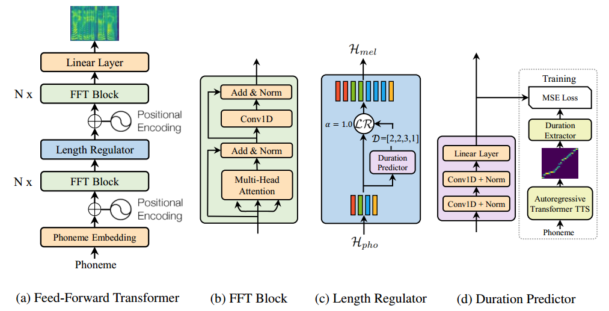

**Vocoder**

Преобразует мел-спектрограмму в звуковую волну ([HiFi GAN, оригинальное исследование 2020 г.](**https://arxiv.org/abs/2006.04558**))


[Пример с официального сайта PyTorch](https://pytorch.org/hub/nvidia_deeplearningexamples_hifigan/)

Мой пример:

```python
from transformers import pipeline
import scipy

synthesiser = pipeline('text-to-speech', 'facebook/mms-tts-rus')
speech = synthesiser('Приятного аппетита тем, кто кушает! А тем, кто еще и пьет - РЕСПЕКТ')

scipy.io.wavfile.write('respect.wav', speech['sampling_rate'], data=speech['audio'][0])
```

[Файл с результатом (respect.wav)](../files/respect.wav)

[Старый ноутбук (Crash Course)](../notebooks/Распознавание и синтез речи (Crash Course).ipynb)
