<!-- source: https://wiki.pmifi.ru/disciplines/nlp/lectures/ssm -->
<!-- updated: 2025-10-17T03:40:21.451Z -->
<!-- author: Михаил Гуненков -->

# Модели пространства состояний (SSM)

## Модели обработки последовательностей

Обработка последовательности - это преобразование некоторой последовательности $x$ в последовательность $y$. Далее будем рассматривать общий случай, при котором $x$ и $y$ могут быть непрерывными (функции $x(t)$ и $y(t)$ соответственно)

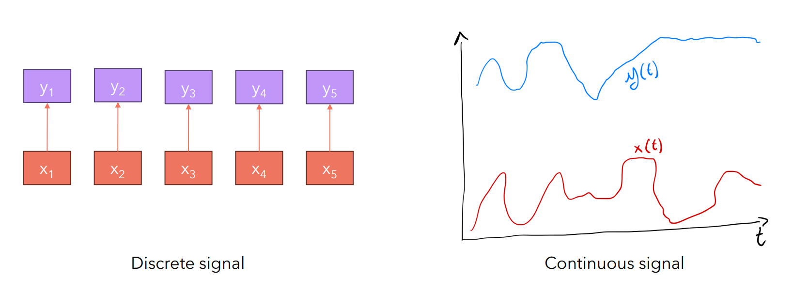

Говоря о языковом моделировании мы говорим о дискретных последовательностях (сигналах), поскольку считаем, что последовательности состоят из конечного количества токенов, которые могут быть пронумерованы.

Еще раз посмотрим на модели для обработки последовательностей, которые знаем:

### Рекуррентные нейронные сети

- бесконечный размер контекста, при этом наблюдается эффект забывания
- есть проблемы с угасающими и взрывающимися градиентами
- асимптотическая сложность алгоритма обучения $O(n)$, при этом **нет возможности распараллелить**
- асимптотическая сложность алгоритма инференса $O(1)$

### Трансформеры

- конечный размер контекста
- асимптотическая сложность алгоритма обучения $O(n^2)$, при этом параллелится (Multi Head Attention)
- асимптотическая сложность алгоритма инференса $O(n)$.

### Идеальный вариант:

- асимптотика $O(n)$ и возможность распараллеливания при обучении
- асимптотика $O(1)$ при инференсе для каждого токена

## Модели пространства состояний

### Определение

Традиционным инструментом моделирования состояния системы $S$ в произвольный момент времени $t$ являются дифференциальные уравнения. Решение уравнения позволяет найти функцию состояния $h(t)$. При этом будем считать, что значение $h(0)$ задано.

Линейной моделью непрерывного пространства состояний (Space State Model) называют следующую пару уравнений:

$\frac{dh}{dt}=Ah(t)+Bx(t),$

$y(t)=Ch(t)+Dx(t),$

где $A$, $B$, $C$ и $D$ - матрицы параметров, которые не зависят от $t$.

Для того, чтобы вычислять значения выходного сигнала на основе входного сигнала необходимо предварительно определить $h(t)$. При этом мы знаем, что аналитическое решение дифференциальных уравнений для реальных систем зачастую затруднительно, если вообще возможно. При этом на практике (в частности в NLP) мы работаем с дискретными сигналами. Рассмотрим дискретизацию модели пространства состояний.

### Дискретизация модели

Найти приближенное решение дифференциального уравнения означает найти последовательность $h(0)$, $h(1)$, $h(2)$, $h(3)$... Таким образом, вместо поиска $h(t)$ мы хотим найти $h(tk)$ = $h(k\Delta)$, где $\Delta$ - это наш размер шага. В примере выше $\Delta=1$.

Рекуррентная формула для дискретизации выводится следующим образом (метод Эйлера):

$\frac{dh}{dt}=\lim_{\Delta\to{0}}\frac{h(t+\Delta)-h(t)}{\Delta},$

считая наш размер шага $\Delta$ достаточно малым получаем:

$\frac{h(t+\Delta)-h(t)}{\Delta}\approx{\frac{dh}{dt}}\approx{h'(t)},$

умножая левую и правую части на $\Delta$ получаем рекуррентную формулу:

$h(t+\Delta)\approx{h'(t)\Delta+h(t)}.$

Таким образом имеем:

$h(t+\Delta)\approx{\Delta{(Ah(t)+Bx(t)) + h(t)}},$

$h(t+\Delta)\approx{\Delta{Ah(t)}+\Delta{Bx(t)}+h(t)},$

$h(t+\Delta)\approx{(I+\Delta{A})h(t)+\Delta{Bx(t)}},$

$h(t+\Delta)\approx{\bar{A}h(t)+\bar{B}x(t)},$

где $I$ - единичная матрица.

Линейная модель дискретного пространства состояний выглядит следующим образом:

$h_t=\bar{A}h_{t-1}+\bar{B}x_t,$

$y_t=Ch_t.$

где $\bar{A}$ и $\bar{B}$ - дискретизированные матрицы.

**При этом:**

- для дискретизации матриц могут использоваться различные подходы; сегодня часто применяется экстраполятор нулевого порядка (Zero-Order Hold); в том числе он используется и в статье по архитектуре Mamba; формулы для вычисления дискретизированных матриц выглядят следующим образом:

$\bar{A}=\exp({\Delta{A})}, \bar{B}=(\Delta{A})^{-1}(\bar{A}-I)(\Delta{B});$

- на практике матрица D в модели пространства состояний не используется, поскольку процесс получения $y_t$ на основе $x_t$ характеризуется матрицами $A$, $B$ и $C$; в этом случае матрица D служит для реализации сквозной связи (skip connection) и в данной модели является избыточной (ранее мы использовали сквозные связи для преодоления проблемы затухающих градиентов);
- $\Delta$ является одним из параметров модели наравне с весами (элементами рассмотренных матриц); таким образом при выполнении алгоритма обратного распространения ошибки мы сможем настраивать дискретизацию модели.

> Предполагается, что размерности элементов входной и выходной последовательностей совпадают

> В случае, когда размерность элементов входной последовательности больше 1, $\Delta$ рассматривается как вектор этой размерности

### Seq2Seq

Дискретная модель пространства состояний является обобщением рекуррентных нейронных сетей. Положим $h_0=0$ (по аналогии - нулевой вектор). Тогда:

$h_1=\bar{B}x_1,$

$y_1=Ch_1.$

Далее:

$h_2=\bar{A}h_1+{\bar{B}x_2},$

$y_2=Ch_2.$

Как обозначалось ранее, такие рекуррентные вычисления отлично подходят для инференса, поскольку в языковых моделях мы всегда генерируем по одному токену за раз, учитывая промпт и ранее сгенерированные токены. Но для обучения рекуррентные вычисления не подходят. Поэтому попробуем использовать то, о чем ранее не говорили в контексте обработки языка - операция свертки.

Обобщим вычисления, приведенные выше:

$h_1=\bar{B}x_1,$

$y_1=Ch_1,$

$h_2=\bar{A}{h_1}+\bar{B}x_2=\bar{A}\bar{B}x_1+\bar{B}x_2,$

$y_2=Ch_2=C(\bar{A}\bar{B}x_1+\bar{B}x_2)=C\bar{A}\bar{B}x_1+C\bar{B}x_2,$

$h_3=\bar{A}{h_2}+\bar{B}x_3=\bar{A}(\bar{A}\bar{B}x_1+\bar{B}x_2)+\bar{B}x_3=\bar{A}^2\bar{B}x_1+\bar{A}\bar{B}x_2+\bar{B}x_3,$

$y_3=C\bar{A}^2\bar{B}x_1+C\bar{A}\bar{B}x_2+C\bar{B}x_3.$

Получаем формулу:

$y_k=C\bar{A}^{k-1}\bar{B}x_1+C\bar{A}^{k-2}\bar{B}x_2+...+C\bar{A}\bar{B}x_{k-1}+C\bar{B}x_k.$

Если рекуррентная формула построена на основе ассоциативной операции (в нашем случае это сумма), значит она может быть распараллелена с помощью следующей технологии:

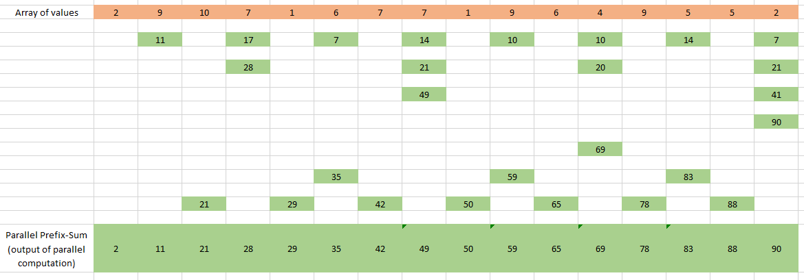

На рисунке выше у нас есть несколько потоков, каждый из которых реализует бинарную операцию (сумму).

**Теорема:**

Выход $y$ может быть вычислен на основе $x$ по рекуррентной формуле за счет применения к последовательности $x$ свертки с ядром $\bar{K}$ следующего вида:

$\bar{K}=(C\bar{A}^{k-1}\bar{B},...,C\bar{A}\bar{B},C\bar{B}),$

где $k$ - длина последовательности, которую мы хотим получить (выходной последовательности). Ядро свертки передставляет из себя последовательность матриц.

**Доказательство:**

Сделаем пару замечаний:

- свертку будем производить перемещением ядра слева-направо, при этом padding последовательности будем выполнять с левой стороны (если padding производится с правой стороны, то свертку необходимо производить справа-налево);
- на рисунках ниже элементы последовательностей нумеруются с нуля, в то время, как в формулах выше они нумеровались с 1; пожалуйста, не запутайтесь 

#### Шаг 0: инициализация ядра

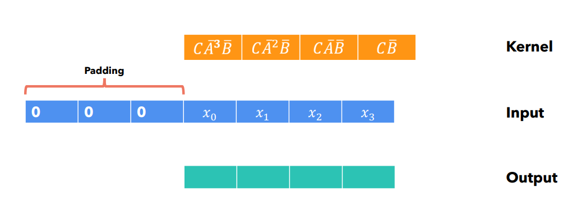

#### Шаг 1:

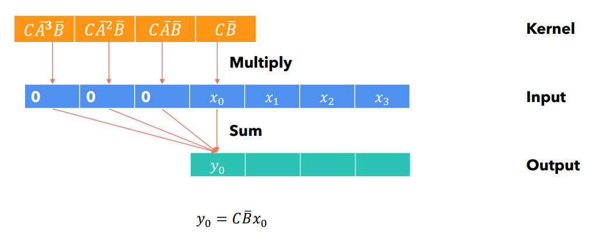

#### Шаг 2:

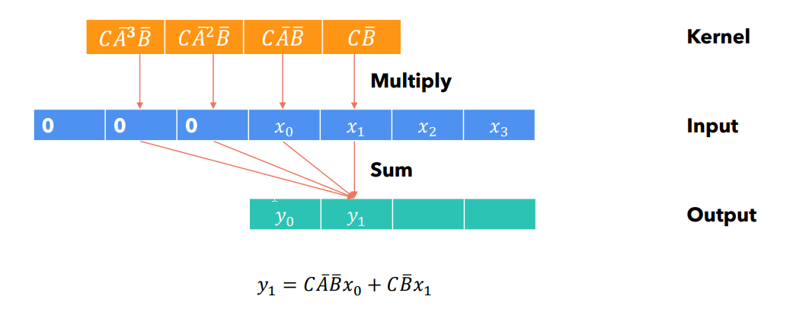

#### Шаг 3:

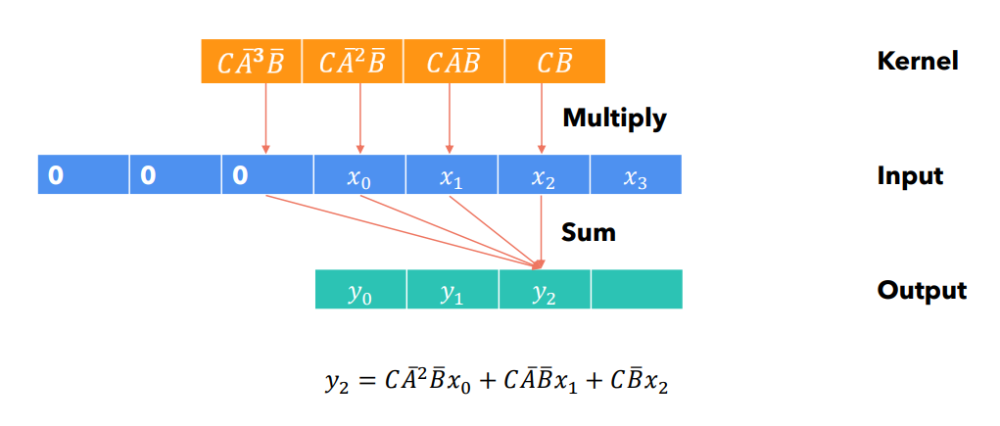

#### Шаг 4:

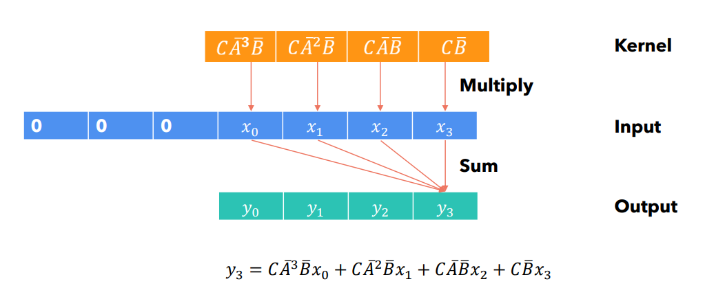

Сверточные вычисления могут быть распараллелены: $y_k$ не зависит от $y_{k-1}$. Каждый элемент выходной последовательности определяется исключительно элементами входной последовательности и параметрами. При этом, в ходе инференса, построение ядра - затратно с точки зрения использования памяти.

**Таким образом:**

- мы можем использовать сверточные вычисления при обучении (есть возможность распараллелить),
- а в ходе инференса для получения элементов выходной последовательности использовать рекуррентную формулу (асимптотика при этом $O(1)$).

### Модель структурированного пространства состояний

В целях улучшения эксплуатационных характеристик моделей необходимо обращать особое внимание на изначальную структуру матрицы $A$, поскольку эта матрица играет ключевую роль - строит новое состояние на основе предыдущего состояния и (что важно) информации обо всех предыдущих состояниях. При этом важно, чтобы актуальное состояние в большей степени определялось последними наблюдаемыми состояниями и в меньшей степени ранними историческими состояниями.

В [исследовании](https://proceedings.neurips.cc/paper/2020/hash/102f0bb6efb3a6128a3c750dd16729be-Abstract.html) 2021 года предлагается инициализировать матрицу $A$ как HiPPO-матрицу:

$A_{nk} = -
\begin{cases}
\sqrt{(2n+1)}\sqrt{(2k+1)} & \text{if n>k}\\
n+1 & \text{if n=k}\\
0 & \text{if n<k}
\end{cases}$

Модели пространства состояний, в которых матрица $A$ инициализируется рассмотренным выше способом, называют моделями структурированного пространства состояний (Structured State Space Model - SSSM, иногда называют S4).

> В S4 матрицы $A$, $B$ и $C$ являются квадратными (размерность элементов входной последовательности $x$ совпадает с размерностью состояния $h$)

## Архитектура Mamba

Данная архитектура описана [в статье](https://arxiv.org/abs/2312.00752) 2023 года, основана на S4 и отличается следующими возможностями:

- выборочное сканирование (Selective Scan): для фильтрации нерелевантной информации из входной последовательности;
- параллелизация рекуррентных вычислений (Parallel Scan) с применением комбинированного ядра свертки.

Архитектура Mamba по-другому называется Selective Structured State Space Model (S6).

### Проблема контекстной осведомленности

В виду отсутствия аналога механизма внимания модель не может концентрироваться на конкретных токенах входной последовательности.

Рассмотрим задачу выборочного копирования (выбрать из последовательности слов только существительные):

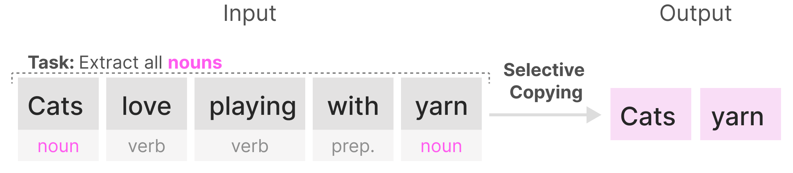

S4 плохо справится с такой задачей, поскольку матрицы $A$, $B$ и $C$ одинаковы для каждого токена входной последовательности.

Также рассмотрим задачу вопроизведения паттернов:

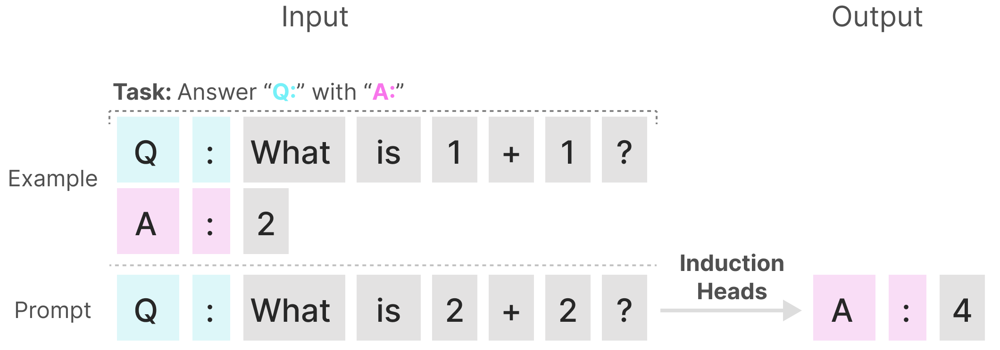

При таком одноразовом промптинге (one-shot prompting) S4 не сможет вспомнить предыдущие токены. Инвариантность модели по времени приводит к проблеме контекстной осведомленности (content-awareness).

### Выборочное сохранение информации

Архитектура Mamba создана, чтобы сохранить преимущества трансформеров и рекуррентных нейронных сетей:

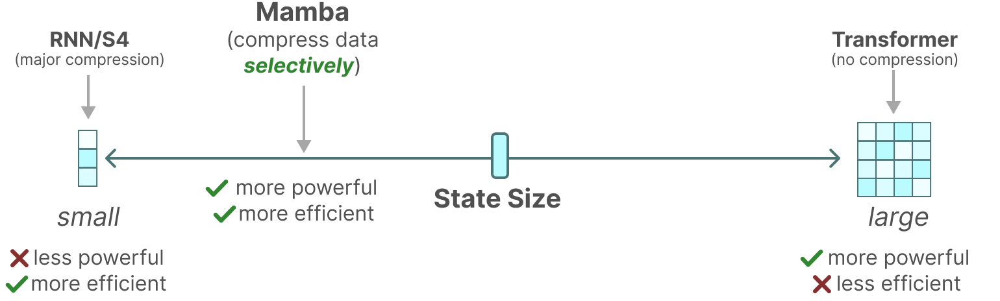

В целях решения проблемы контекстной осведомленности авторы Mamba предложили свой вариант вычисления матриц $A$, $B$, $C$ и шага $\Delta$. Модификация предполагает добавление в модель обучаемых линейных слоев:

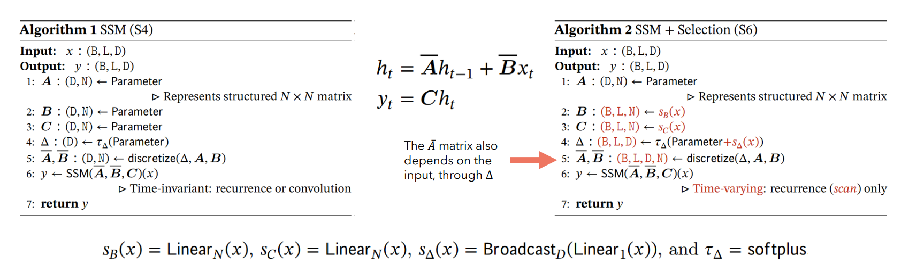

Здесь:

- $B$ - размер батча;
- $L$ - длина входной и выходной последовательности (по аналогии с транформерами мы ее фиксируем);
- $D$ - размерность элементов входной последовательности;
- $N$ - размерность состояния;
- Linear - линейный слой (без активации);
- Broadcast - [операция транслирования тензоров](https://www.geeksforgeeks.org/deep-learning/tensor-broadcasting/)
- softplus - функция активации (также называемая "мягкой" ReLU); значение вычисляется по формуле $f(x)=\log({1+e^{x}})$.

### Блок Mamba

Подобно трансформерам модель Mamba представляется в виде нескольких последовательно размещенных блоков. Один блок выглядит следующим образом:

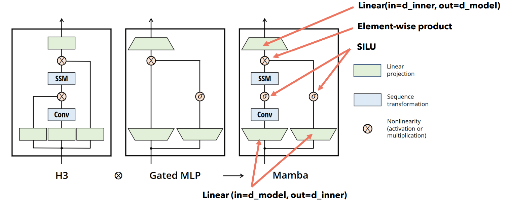

Рассматриваемая архитектура основана на архитектуре Hungry Hungry Hippo (H3) и подходе с использованием сквозной связи вместе с передаточной функцией (функцией активации).

Здесь Conv - это полноценный обучаемый сверточный Seq2Seq-слой, а SILU - функция активации $s(x)=x\sigma(x)$, где $\sigma({x})$ - сигмоид.

Основные гиперпараметры модели:

- размерность внутреннего эмбеддинга (d\_model, а на рисунке это d\_inner!);
- размерность вектора состояния (d\_state, обычно совпадает с d\_model);
- размерность ядра свертки (d\_conv);
- количество блоков.

В целом модель в архитектуре Mamba выглядит следующим образом:

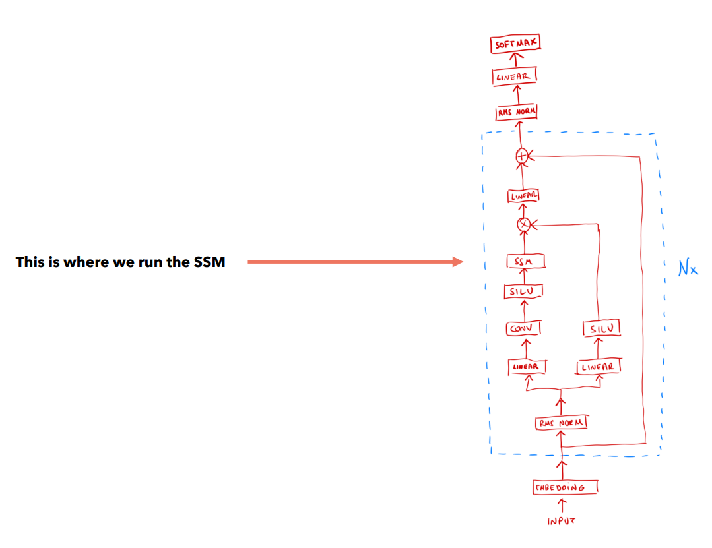

Здесь RMS Norm - это Root Mean Square Layer Normalization:

${\bar{a_i}}=\frac{a_i}{RMS(a_i)},RMS(a)=\sqrt{\frac{1}{n}\sum_{i=1}^{n}a_i^2}.$

Применяется к каждому вектору входной последовательности. Следует помнить про отличие Layer Norm от Batch Norm:

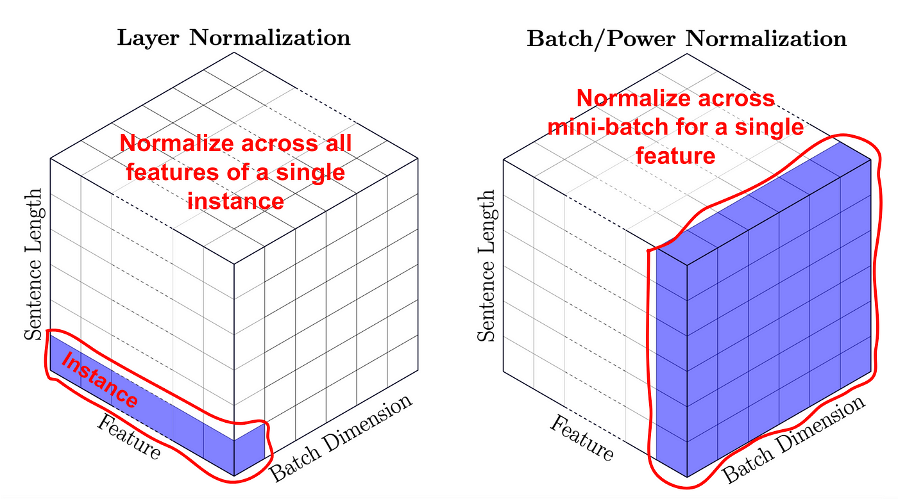

## Выводы

Несмотря на высокие показатели эксплуатационных характеристик (метрик) качества и широкое распространение в современных LLM, архитектура **Transformer не идеален**. Актуальные задачи требуют увеличения контекста, а следовательно увеличения размеров входных и выходных последовательностей при инференсе. Возможность распараллеливания обучения не спасает трансформеры от замедляющегося по мере увеличения размера выходной последовательности инференса.

Современные исследования в области Seq2Seq изучают различные способы улучшения рекуррентных вычислений, интегрируя в классические схемы с состоянием аналоги механизма внимания.

Одним из последних достижений в области языкового моделирования является архитектура Mamba. Ее авторы развили идеи моделей пространства состояний, предложив решение проблемы контекстной осведомленности. Известные разработчики LLM (например Mistral AI) [уже интегрируют](https://mistral.ai/news/codestral-mamba/) эту архитектуру в свои решения. Исследовали продолжают работу в направлении повышения эффективности обработки тензоров на GPU.

Реализация Mamba представлена в виде [репозитория](https://github.com/state-spaces/mamba) и пакета **mamba-ssm** для PyPI.

Модель также можно попробовать на HuggingFace с помощью библиотеки transformers. Несколько любопытных ссылок:

- [оригинальная Mamba 2.8b](https://huggingface.co/state-spaces/mamba-2.8b-hf)
- [Mamba 1.4b для русского языка](https://huggingface.co/SpirinEgor/mamba-1.4b-ru)
- [Codestral 22b для генерации кода](https://huggingface.co/mistralai/Codestral-22B-v0.1)
