<!-- source: https://wiki.pmifi.ru/disciplines/nlp/lectures/transformer-2 -->
<!-- updated: 2025-10-03T06:16:59.521Z -->
<!-- author: Михаил Гуненков -->

# Архитектура Transformer. Attention is all you need V2

В лекции используются иллюстрации [из блога Jay Alammar](https://jalammar.github.io/).

## Введение

Рекуррентные нейронные сети находились на волне хайпа первую половину прошлого десятилетия. В 2014 году была представлена архитектура GRU, проблема затухающих градиентов была решена.

При этом главная особенность рекуррентных сетей, — **низкая скорость обучения**, никуда не делась.

В виду рекуррентности вычисления на блоках сети не могут выполняться параллельно. Это несмотря на то, что по сути мы обучаем один блок с одним набором весов, после чего применяем его к каждому токену входной последовательности.

В то же время мы помним, что фиксированный размер скрытого состояния является “бутылочным горлышком” рекуррентных моделей. Требуется информация не только о входной последовательности в целом, но и о подпоследовательностях.

Решением проблемы стал механизм внимания, который расширил границы понимания естественного языка. Люди начали искать ответ на вопрос: можно ли уйти от рекуррентности и построить языковую модель, которая будет работать **только с использованием внимания**.

## Общая архитектура Transformer

В 2017 году выходит статья [Attention is all you need](https://arxiv.org/abs/1706.03762) — научная работа, которая перевернула не только NLP, но и все глубокое обучение в целом.

В статье авторы представили архитектуру модели Seq2Seq для машинного перевода, которую назвали Transformer. Она точно также включает в себя Encoder и Decoder, однако при этом в ней нет никаких рекуррентных блоков. Вместо них операции над матрицами, позиционное кодирование и главная фишка — Multi-head attention.

Новая модель показала невероятные результаты, обогнала модели RNN с вниманием по метрике BLEU. При этом, скорость обучения заметно выше, чем у RNN. Вычисления могут проводиться параллельно.

Схема Трансформера в общем виде выглядит следующим образом:

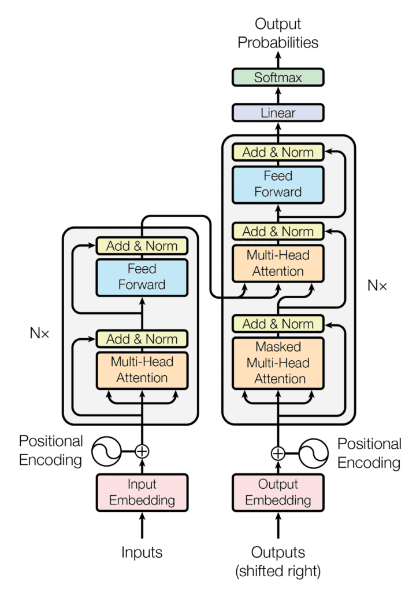

Стандартная реакция обычно следующая:

Классический Трансформер - это **Seq2Seq модель**.

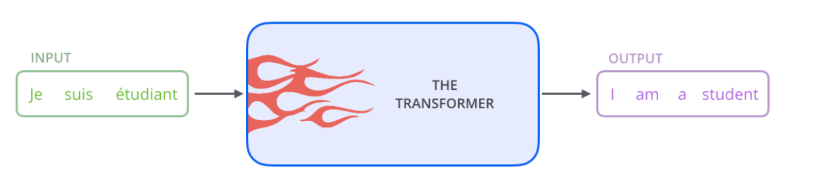

Трансформер имеет множество кодировщиков и множество декодировщиков (в оригинальной статье $N=6$).

> Количество кодировщиков необязательно должно быть равно числу декодировщиков

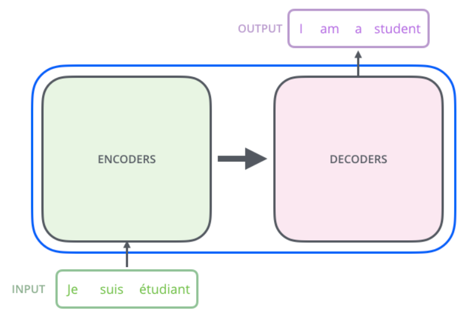

**Задача кодировщиков** — принять на вход последовательность векторных представлений токенов и преобразовать ее в обогащенную контекстом последовательность векторов той же длины.

**Задача декодировщиков** — сгенерировать последовательность токен за токеном (авторегрессионно). Стек декодировщиков принимает на вход два типа информации:

- результат работы всего стека кодировщиков
- последовательность токенов, сгенерированную им на предыдущих шагах

> Выход стека кодировщиков **подается в каждый слой** стека декодировщиков, сопоставьте это с вниманием в RNN

> Входными данными являются **матрицы**, составленные из векторных представлений токенов, на выходе также получаются матрицы

> **Особенность архитектуры** — устройство внутреннего потока данных

## Позиционное кодирование

Итак, векторные представления токенов собираются в матрицу (один вектор соответствует одной строке матрицы). Таким образом уходим от рекуррентности — от необходимости последовательной обработки токенов по одному.

Можно заметить, что теперь **нет информации о порядке токенов** во входной последовательности. Теряется основное преимущество рекуррентных сетей. Для решения этой проблемы авторы Трансформера предлагают использовать **позиционное кодирование** (Positional Encoding).

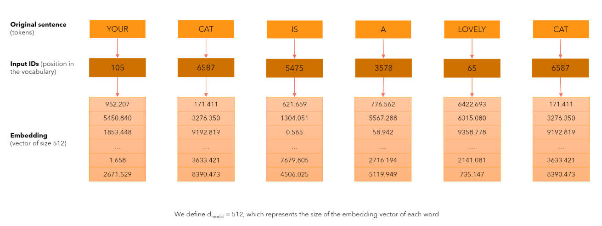

Размерность эмбеддинга $d_{model}$ установим 512 (так предлагается в оригинальной статье).

Позиционное кодирование представляет собой сложение эмбеддингов с некоторыми уникальными (позиционными) векторами, которые характеризуют позицию токена в тексте.

> Позиционные вектора **никак не зависят от самих токенов - они вычисляются заранее.**

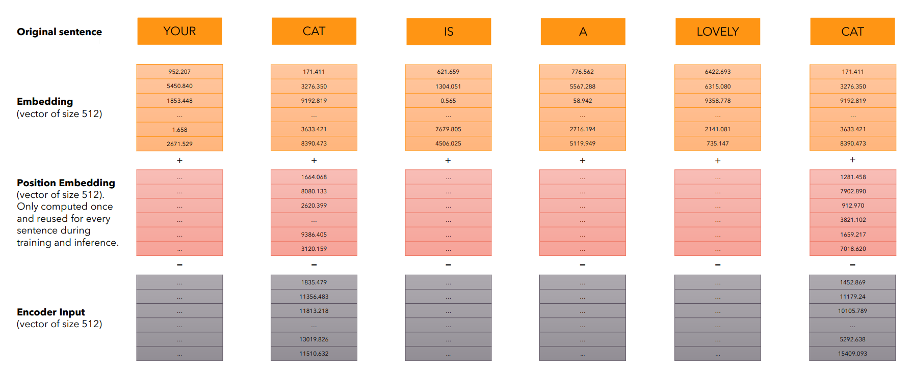

В оригинальной статье авторы предложили использовать для этого синусоидальные функции разных частот:

$PE_{(pos, 2i)} = \sin\left(\frac{pos}{10000^{2i/d_{\text{model}}}}\right)$

$PE_{(pos, 2i+1)} = \cos\left(\frac{pos}{10000^{2i/d_{\text{model}}}}\right)$

Здесь:

- $pos$ — позиция слова в предложении (0, 1, 2,...)
- $i$ — индекс компоненты вектора эмбеддинга (от 0 до $d_{\text{model}}/2 - 1$)
- $d_{\text{model}}$ — размерность эмбеддинга (в нашем случае 512)

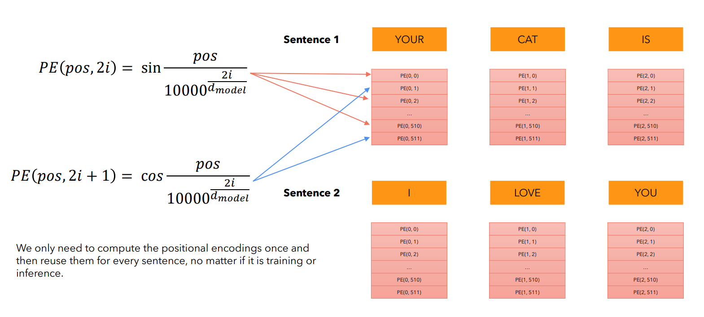

> Каждое измерение позиционного вектора соответствует синусоиде (косинусоиде) с уникальной частотой

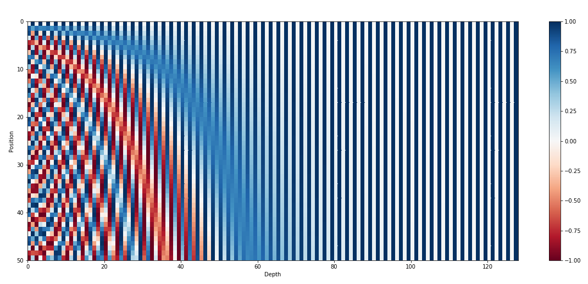

Позиционный вектор не просто должен быть уникальным. Важно, чтобы на основе известного позиционного вектора (для некоторой позиции t) мы могли бы **независимо от абсолютной позиции $t$** вычислить позиционный вектор для любой другой позиции ($t + w$).

> Модель научиться обращать внимание на слова, находящиеся на определенном расстоянии друг от друга, независимо от их абсолютной позиции в предложении

Покажем, что используемый метод получения позиционного вектора обладает вышеуказанным свойством:

$M \cdot \begin{bmatrix} \sin(\omega_k t) \\ \cos(\omega_k t) \end{bmatrix} = \begin{bmatrix} \sin(\omega_k (t + \phi)) \\ \cos(\omega_k (t + \phi)) \end{bmatrix}$

Покажем, что существует линейная трансформация $M$ (не зависит от $t$ — текущей позиции), с помощью которой можно вычислить позиционный вектор **для любой другой позиции**:

$\begin{bmatrix} u_1 & v_1 \\ u_2 & v_2 \end{bmatrix} \cdot \begin{bmatrix} \sin(\omega_k t) \\ \cos(\omega_k t) \end{bmatrix} = \begin{bmatrix} \sin(\omega_k (t + \phi)) \\ \cos(\omega_k (t + \phi)) \end{bmatrix}$

Далее:

$\begin{aligned}
u_1 \sin(\omega_k t) + v_1 \cos(\omega_k t) &= \cos(\omega_k \phi) \sin(\omega_k t) + \sin(\omega_k \phi) \cos(\omega_k t) \\
u_2 \sin(\omega_k t) + v_2 \cos(\omega_k t) &= -\sin(\omega_k \phi) \sin(\omega_k t) + \cos(\omega_k \phi) \cos(\omega_k t)
\end{aligned}$

Продолжаем:

$\begin{aligned}
u_1 &= \cos(\omega_k \phi) & v_1 &= \sin(\omega_k \phi) \\
u_2 &= -\sin(\omega_k \phi) & v_2 &= \cos(\omega_k \phi)
\end{aligned}$

Получившаяся матрица $M$ не зависит от $t$. Значит, линейное преобразование с нужным свойством существует.

> Позиционное кодирование применяется как в кодировщике, так и в декодировщике

## Self-Attention

**Напоминание:** в общем виде, функцию внимания можно описать как отображение "запроса" (query) и набора пар "ключ-значение" (key-value) в выходной вектор (запросы, ключи и значения являются также векторами). Этот выход вычисляется как взвешенная сумма "значений", где вес, присвоенный каждому "значению", определяется функцией совместимости "запроса" с соответствующим "ключом".

> Идея — для каждого токена **оценить влияние** на него других токенов (для упрощения — слов)

В Transformer используется конкретная реализация механизма внимания, называемая **Scaled Dot-Product Attention**. Ее работа описывается следующей формулой:

$\text{Attention}(Q, K, V) = \text{softmax}\left( \frac{QK^T}{\sqrt{d_k}} \right) V$

Разберем формулу по частям, используя аналогию с поиском информации в библиотеке. Пишем статью, ищем нужные книги. Тогда:

- **Query (Q, Запрос):** исследовательский вопрос или ключевая тема; для каждого слова его вектор-запрос $q$ — "зонд", который оно использует для поиска релевантной информации в остальной части текста
- **Keys (K, Ключи):** заголовки книг; каждое слово в тексте имеет свой вектор-ключ $k$, который объявляет о его содержании и тематике, эти ключи сравниваются с запросом
- **Values (V, Значения):** содержание книг; Вектор-значение $v$ каждого слова — его информационная сущность, которую хотим извлечь, если слово окажется релевантным (в соответствии с некоторой степенью релевантности)

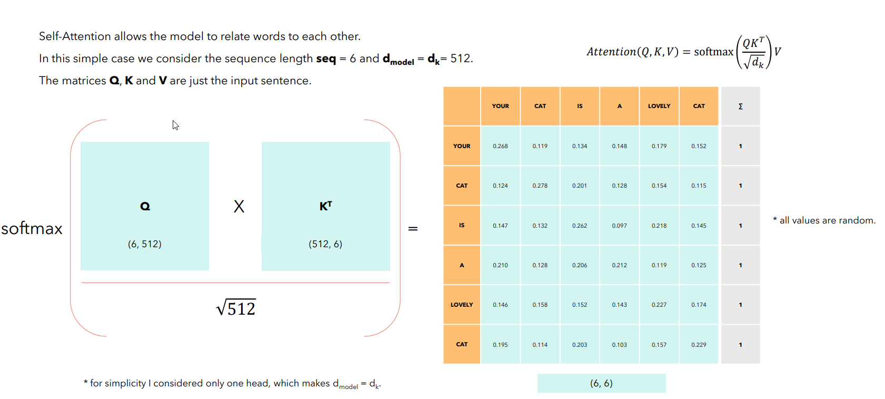

В получившейся матрице содержатся **веса внимания** — насколько каждое слово связано со всеми остальными (проведите аналогию с вниманием в RNN).

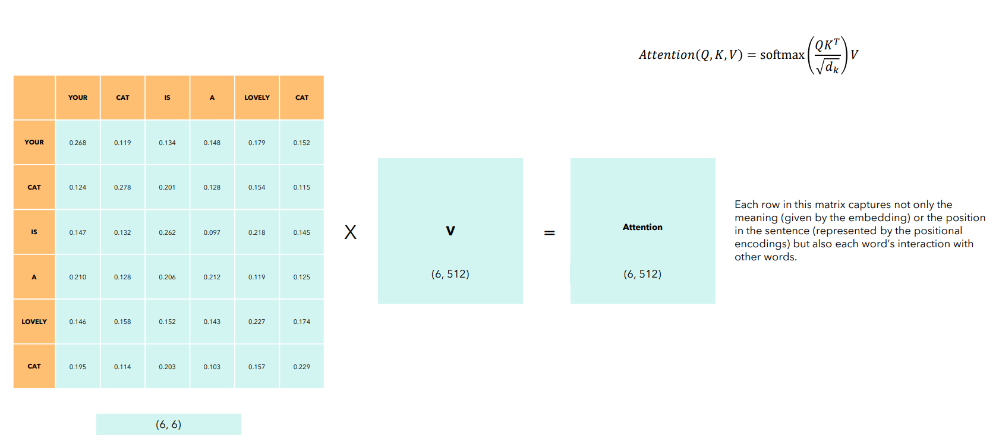

Получившаяся матрица имеет такой же размер, как и входная. **Слой Self Attention не изменяет размеры входных данных.**

> **Философия:** для каждого слова вектора $q$, $k$, $v$ соответствуют "что я ищу, что я содержу, и что я могу дать"

> $Q,K,V$ на данном слое как правило получаются в результате умножения результата предыдущего слоя (матрицы) на обучаемые матрицы $W^Q, W^K, W^V$

Для улучшения качества работы Трансформеров предложен подход **Multi-Head Self Attetntion**. При таком подходе инициализируем матрицы $W^Q, W^K, W^V$ и $W^O$. Все это — обучаемые параметры.

$Q, K$ и $V$ делятся на несколько меньших частей, которые называются **"головами"**. Каждая "голова" получает урезанную версию $Q, K$ и $V$.

.png)

Вычисления для каждой "головы" **независимы друг от друга**. После создания общих $Q, K$ и $V$ и разделения на части расчет внимания для HEAD 1, HEAD 2, HEAD 3 и HEAD 4 может выполняться параллельно.

> Подход позволяет улавливать **различные типы связей** между словами

## Полносвязные слои и нормализация

Важный компонент — это простые, двухслойные полносвязные нейронные сети (Feed-Forward Network), которые применяются к каждому векторному представлению токена **индивидуально**. Структура описывается формулой:

$\text{FFN}(x) = \max(0, xW_1 + b_1)W_2 + b_2$

Здесь $x$ — это вектор токена после слоя self-attention, $W_1, W_2, b_1, b_2$ — это обучаемые матрицы весов и смещений, а в качестве функции активации используется ReLU.

Одни и те же веса ($W_1, W_2$) и смещения ($b_1, b_2$) используются для каждого токена в последовательности. Это"индивидуальная обработка": после того как каждый токен собрал информацию от соседей на этапе self-attention, он обрабатывает эту информацию с помощью нелинейного преобразования FFN.

MHA и FFN обернуты в два дополнительных компонента: **остаточное соединение** (Residual Connection) и **нормализацию по слою** (Layer Normalization). Полная операция для каждого подслоя выглядит так:

$\text{Output} = \text{LayerNorm}(x + \text{Sublayer}(x))$

где $x$ — это вход в подслой, а $\text{Sublayer}(x)$ — это функция, реализуемая самим подслоем.

Здесь:

- **Residual Connection** ($x + \dots$): остаточное соединение; идея в том, чтобы добавить выход подслоя к его же входу; исходная информация $x$ проходит напрямую, в обход сложного преобразования; подслою нужно выучить только дельту (residual), которую нужно внести в исходный вектор $x$; это решает проблему затухания градиентов
- **Layer Normalization** ($\text{LayerNorm}(\dots)$): техника стабилизации; после добавления остаточного соединения полученный вектор нормализуется; нормализация происходит для каждого вектора в последовательности независимо: вычисляется среднее и стандартное отклонение по всем его компонентам, и затем вектор масштабируется (`Standart Scaler`)

## Декодировщик и Masked Self-Attention

Первый подслой — также Multi-Head Self-Attention, но с важным дополнением: **маскированием**. Поскольку декодировщик работает авторегрессионно, при генерации слова на позиции $t$ он должен иметь доступ только к уже сгенерированным словам с позиций от $1$ до $t−1$.

Это достигается путем применения маски к матрице оценок внимания перед шагом `softmax`. Маска заменяет все значения, соответствующие будущим позициям, на $−∞$. После применения softmax эти значения превратятся в нули.

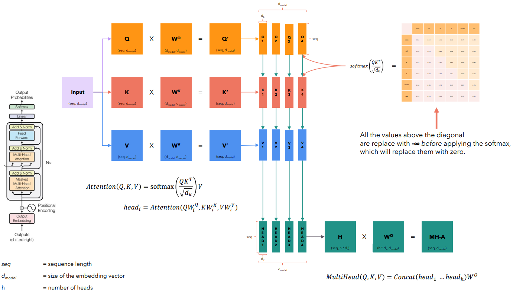

> **Обратите внимание:** на слое Multi-Head Self-Attention запросы поступают из предыдущего подслоя декодировщика (Masked Multi-Head Self-Attention), а ключи и значения — с выхода всего стека кодировщиков

## Обучение и инференс Трансформера

Предположим, решаем задачу машинного перевода. Обучение реализуется за один шаг:

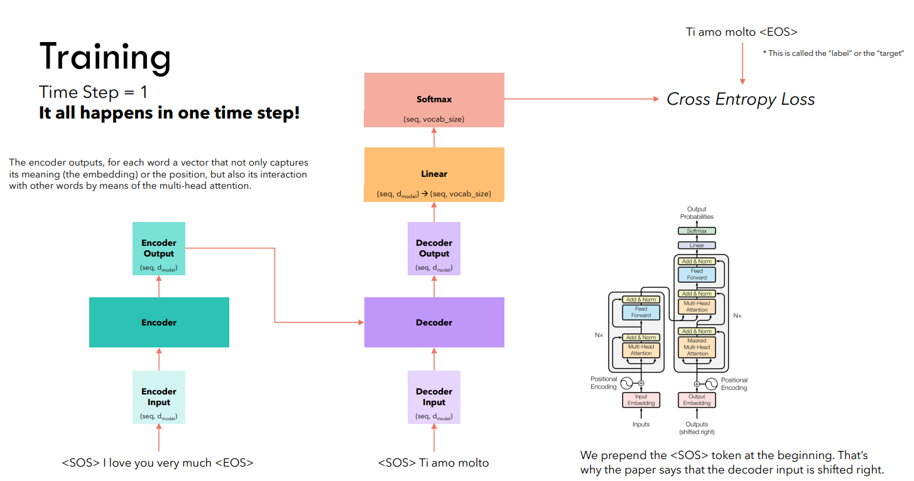

Выходы декодировщика обрабатываются минимум одним линейным слоем, который реализует трансформацию данных (переход к размерности словаря). Теперь для каждой строки полученной матрицы выполняется `softmax`, определяются индексы максимальных элементов, после чего вычисляется общая категориальная перекрестная энтропия (сумма `negative log probability` для каждого сгенерированного токена).

В отличие от обучения, инференс трансформера выполняется по шагам. На первом шаге получения предсказания подаем на вход декодировщика токен `<SOS>` и предсказываем первый токен.

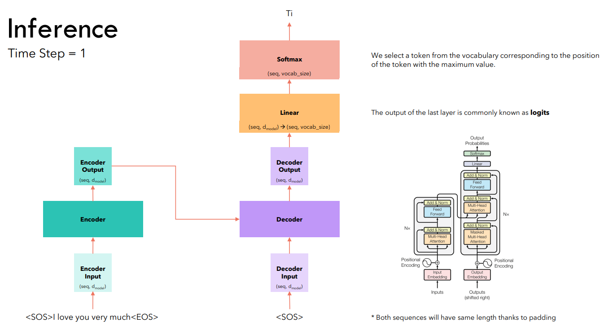

На последующих шагах подаем на вход декодировщику всю сгенерированную им ранее последовательность. Продолжаем генерацию до тех пор, пока не будет предсказан токен `<EOS>`.

> Выходом трансформера является матрица, количество строк в которой равно количеству входящих в кодировщик токенов. На этапе инференса нас интересуют строка, номер которой соответствуют номеру **предсказываемого в данный момент** токена.

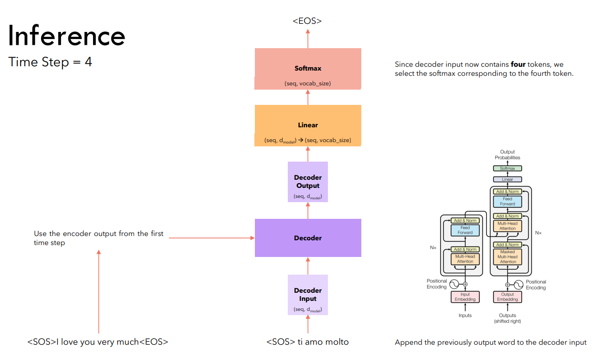

Предсказан токен `<EOS>`, генерация останавливается.

> При работе с Seq2Seq-моделями целесообразно **заранее определить** максимальный размер генерируемой последовательности. В таком случае инференс заканчивается либо когда предсказывается токен , либо когда длина сгенерированной последовательности достигает максимального значения.

## Выводы

Представленная в 2017 году архитектура Трансформер наглядно показала, что эффективно решать задачи Seq2Seq можно без последовательной обработки последовательностей, а только с использованием внимания и классических нейронных сетей.

Трансформеры легко распараллеливаются, обучаются быстрее чем рекуррентные нейронные сети.

> Практически все современные модели в NLP построены на основе архитектуры Трансформер

**Среди них:**

- BERT (включая модификации RoBERTa, DistilBERT), T5, Gemma (Gemini) — Google
- GPT 1, 2, 3, 3.5 (ChatGPT), 4, 5 — OpenAI
- LLAMA — Meta (на момент написания материала деятельность компании в РФ запрещена)
- DIET (фреймворк RASA) — RASA
- Phi — Microsoft

И многие другие...

> Transfer Learning трансформеров — **основное направление** в современном NLP
