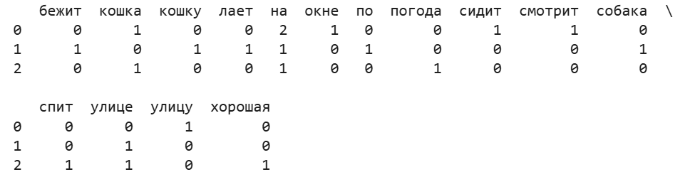
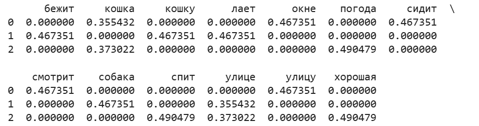
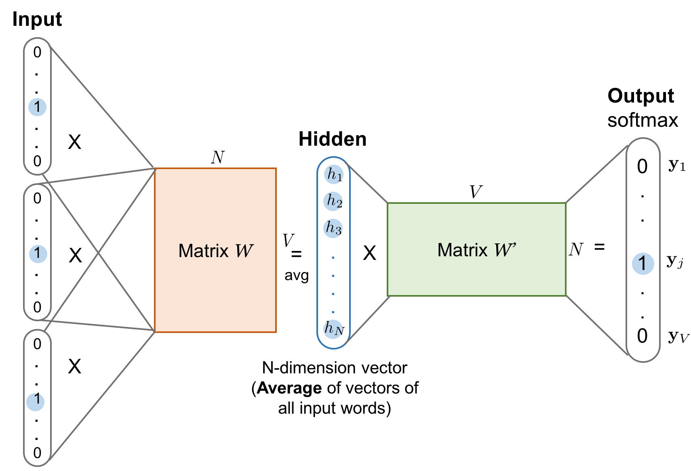
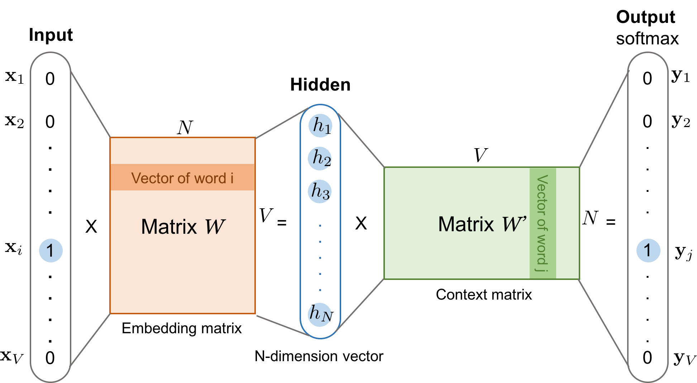
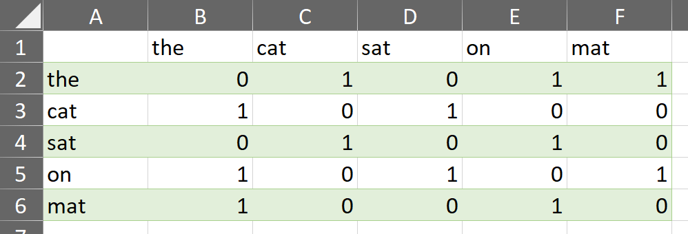

<!-- source: https://wiki.pmifi.ru/disciplines/nlp/lectures/vectorization -->
<!-- updated: 2025-09-04T13:30:05.470Z -->
<!-- author: Михаил Гуненков -->

# Векторные представления текстовых данных

## Введение

Фундаментальная задача NLP: научить компьютер "понимать" человеческий язык. При работе с алгоритмами ML мы оперируем не токенами, а числами, векторами и матрицами. Важнейшим этапом решения задач NLP является процесс **векторизации текстовых данных**.

В задачах, связанных с искусственным интеллектом, данные могут быть:

- структурированные (таблицы, DataFrame, изображения)
- неструктурированные (текст, звук)

**Структурированные данные** — данные, которые можно представить в виде списка (множества) векторов. Неструктурированные данные требуется привести к виду, в котором они могут быть представлены в виде списка векторов.

Каждый элемент вектора, который характеризует объект данных, называется **признаком** (feature). В виду этого процесс векторизации является **процессом извлечения признаков** (feature extraction).

В NLP на уровне данных применяется следующая терминология:

- датасет (набор данных) - **коллекция (корпус) текстовых документов**
- объект датасета - **текстовый документ**

Важно заметить, что на уровне символьной токенизации кодировки по типу ASCII решают задачу векторизации, но они не несут никакой **информации о значении слов**. С точки зрения кодов ASCII, слова "кот" и "кошка" не имеют между собой ничего общего, кроме совпадающих кодов для букв "к" и "о". Их числовые представления будут так же далеки друг от друга, как и от слова "ракета".

> **Цель векторизации** в современном NLP — создание многомерного семантического пространства, в котором геометрия отражает смысловые отношения между языковыми единицами

**Два основных подхода к векторизации токенов:**

- **частотные модели** (вектор слова или документа можно определить через частоту встречаемости слов), легко реализуемы и интерпретируемы, но генерируют векторы разреженные векторы, размерность которых равна размеру словаря
- **предиктивные модели** (плотные эмбеддинги), обучаются предсказывать слово на основе его окружения (контекста) или наоборот (применяются нейронные сети)

## Частотные модели

> Здесь и далее токенизация рассматривается на уровне слов; говорим о задачах понимания естественного языка, а не о языково моделировании

### One-Hot Encoding

Простейший метод преобразования категориальных данных. Принцип заключается в следующем:

- составляется словарь всех уникальных слов (токенов), встречающихся в корпусе текстов.
- каждому слову из словаря присваивается уникальный целочисленный индекс
- каждое слово представляется в виде вектора, размерность которого равна размеру словаря; в этом векторе все элементы равны нулю, за исключением элемента с индексом, соответствующим данному слову, который равен единице

Если наш словарь состоит всего из четырех слов: `["мама", "мыла", "раму", "сегодня"]`, то представления будут следующими:

```
"мама": [1, 0, 0, 0]
"мыла": [0, 1, 0, 0]
"раму": [0, 0, 1, 0]
"сегодня": [0, 0, 0, 1]
```

**Ключевой недостаток:** ортогональность векторов; скалярное произведение векторов любых двух разных слов всегда равно нулю. Это означает, что все слова в получаемом векторном пространстве являются независимыми. Модель не содержит никакой информации о семантической близости.

### Bag of Words (BoW)

Основная идея заключается в представлении каждого документа как неупорядоченного набора слов, где важна исключительно частота их появления (порядок слов игнорируются).

Процесс создания BoW-представления для корпуса документов выглядит так:

- документы разбиваются на отдельные слова (токены)
- формируется словарь всех уникальных токенов из корпуса
- каждый документ представляется в виде вектора, размерность которого равна размеру словаря. Каждое значение в векторе соответствует количеству вхождений (частоте) слова из словаря в данный документ.

Два документа:

```
Документ 1: "Мама мыла раму, раму мыла мама."
Документ 2: "Мама сегодня мыла окно."
```

Словарь (после приведения к нижнему регистру и удаления знаков препинания): `["мама", "мыла", "раму", "сегодня", "окно"]`.  
BoW-векторы для документов будут следующими:

```
Документ 1: [2, 2, 2, 0, 0]
Документ 2: [1, 1, 0, 1, 1]
```

**Важные недостаток:** потеря порядка слов и контекста ("собака укусила человека" и "человек укусил собаку") - **общая проблема всех подходов к векторизации на уровне токенов.**

Пример:

```python
import pandas as pd
from sklearn.feature_extraction.text import CountVectorizer

corpus = [
    'Кошка сидит на окне и смотрит на улицу',
    'Собака бежит по улице и лает на кошку',
    'На улице хорошая погода, кошка спит'
]

# Инициализация CountVectorizer
# автоматически выполнит токенизацию и приведет слова к нижнему регистру!
vectorizer = CountVectorizer()
X = vectorizer.fit_transform(corpus)

print("Словарь:", vectorizer.get_feature_names_out())

bow_matrix = X.toarray()

df_bow = pd.DataFrame(bow_matrix, columns=vectorizer.get_feature_names_out())
print(df_bow)
```



Для повышения качества BoW-модели проводится предварительная обработка текста: токенизацию, приведение к нижнему регистру, удаление пунктуации, удаление стоп-слов и лемматизация.

### Term Frequency-Inverse Document Frequency (TF-IDF)

Идея: вес слова в документе должен быть пропорционален его частоте в этом документе (локальный компонент) и обратно пропорционален его частоте во всем корпусе документов (глобальный компонент). Слова, которые часто встречаются в конкретном документе, но редко в остальных, получают наибольший вес.

$TF(t, d) = \frac{\text{Количество вхождений слова } t \text{ в документ } d}{\text{Общее число слов в документе } d}$

> Чтобы избежать влияния длины документа может использоваться нормализованное значение

Классическая формула:

$IDF(t, D) = \log \frac{N}{|\{d \in D : t \in d\}|}$

`N` — общее число документов в корпусе, а знаменатель — число документов, содержащих слово `t`.

Формула со сглаживанием:

$IDF(t, D) = \log \frac{1 + N}{1 + |\{d \in D : t \in d\}|} + 1$

Сглаживание используется для решения двух основных проблем:

- предотвращение деления на ноль для неизвестных слов
- предотвращение нулевого веса для слов, присутствующих во всех документах

$TF-IDF(t, d, D) = TF(t, d) \times IDF(t, D)$

Пример:

```python
import pandas as pd
from sklearn.feature_extraction.text import TfidfVectorizer
import nltk
from nltk.corpus import stopwords

nltk.download('stopwords')
russian_stopwords = stopwords.words("russian")

corpus = [
    'Кошка сидит на окне и смотрит на улицу',
    'Собака бежит по улице и лает на кошку',
    'На улице хорошая погода, кошка спит'
]

tfidf_vectorizer = TfidfVectorizer(stop_words=russian_stopwords)
X_tfidf = tfidf_vectorizer.fit_transform(corpus)

df_tfidf = pd.DataFrame(X_tfidf.toarray(), columns=tfidf_vectorizer.get_feature_names_out())
print(df_tfidf)
```



## Предиктивные модели

### Дистрибутивная гипотеза

Частотные модели не улавливают семантическую связь между словами. John Firth сформулировал **дистрибутивную гипотезу**:

> "You shall know a word by the company it keeps" ("Слово узнается по его окружению")

Основная идея в том, что слова, которые встречаются в схожих контекстах, имеют **схожие значения**. Например, слова "кофе" и "чай" часто встречаются в контексте слов "чашка", "горячий", "сахар", "пить". Следовательно, их векторные представления **должны быть близки**. Плотные векторы, получаемые с применением предиктивных моделей, имеют значительно меньшую размерность (обычно от 50 до 300).

### Word2Vec

Подход [представлен в 2013 году](https://arxiv.org/abs/1301.3781) командой Google под руководством Tomáš Mikolov. Два метода:

- **Continuous Bag-of-Words (CBoW):** модель предсказывает текущее (центральное) слово на основе его контекста (окружающих слов). Например, для предложения "кошка сидит на \_\_\_ и смотрит", модель пытается предсказать слово "окне". Входными данными являются векторы контекстных слов (кошка, сидит, на, и, смотрит), которые обычно усредняются, а выходными — предсказанный вектор центрального слова.  
  
- **Skip-Gram:** решается обратная задача: предсказываются контекстные (окружающие) слова на основе одного центрального слова. Для того же примера, получив на вход слово "окне", модель будет пытаться предсказать слова кошка, сидит, на, и, смотрит.  
  

Для Skip-Gram вероятность предсказания контекстного слова `w_O` (соответствует вектор `v'_{w_O}}`) при заданном центральном слове `w_I` (соответствует вектор `v_{w_I}`) вычисляется с помощью функции Softmax:

$P(w_O | w_I) = \frac{\exp({v'_{w_O}}^T v_{w_I})}{\sum_{j=1}^{V} \exp({v'_{w_j}}^T v_{w_I})},$

- $V$ — размер словаря

Функция потерь - отрицательное логарифмическое правдопободие:

$J = -\log P(w_O | w_С)$

> Проблема: очень большое количество слагаемых в знаменателе

Негативное семплирование (Negative Sampling):

$J = -\log \sigma({v'_{w_o}}^T v_{w_c}) - \sum_{i=1}^{k} \log \sigma(-{v'_{w_{n_i}}}^T v_{w_c})$

- $\sigma$ — сигмоидальная функция $\sigma(x) = \frac{1}{1 + e^{-x}}$
- $k$ — количество негативных примеров

> "Сделай так, чтобы векторы этих двух слов, которые реально встречаются вместе, были как можно более похожими".

> "А для этих `k` случайных пар слов, которые вместе не встречаются, сделай их векторы как можно менее похожими"

### Global Vectors for Word Representation (GloVe)

Предложен в 2014 году.

Алгоритм анализирует, как часто слова встречаются вместе в большом объеме текста, чтобы создать векторы, которые отражают семантические отношения между словами.

На первом этапе GloVe строит матрицу со-встречаемости слов (co-occurrence matrix). Эта матрица $X$ показывает, сколько раз каждое слово $j$ появляется в контексте слова $i$. Контекст определяется размером "окна" — количеством слов до и после целевого слова.

Словарь уникальных слов: `['the', 'cat', 'sat', 'on', 'mat']`.



Далее вводим весовую функцию (аргументами являются ячейки матрицы со-встречаемости):

$f(x) = \begin{cases}
(x/x_{\max})^\alpha & \text{если } x < x_{\max} \\
1 & \text{в противном случае}
\end{cases}$

В [оригинальной статье](https://www-nlp.stanford.edu/pubs/glove.pdf) от авторов алгоритма значения гиперпараметров $x_{max}=100$ (предотвратить влияние часто встречающихся пар слов), $\alpha=0.75$ (регулятор кривизны функции).

Функция потерь:

$J = \sum_{i,j=1}^V f(X_{ij}) \left(w_i^T \tilde{w}_j + b_i + \tilde{b}_j - \log(X_{ij})\right)^2$

- $V$ — объем словаря
- $X_{ij}$ — количество раз, когда слово $j$ появилось в контексте $i$
- $w_i$ — вектор целевого слова $i$ (обучаемые параметры)
- $\tilde{w}_j$ — вектор контекстного слова $j$ (обучаемые параметры)
- $b_i$ и $\tilde{b}_j$ — смещения (bias) для целевого и контекстного слов (обучаемые параметры)
- $f(X_{ij})$ — весовая функция

В самом начале все эти векторы и смещения заполняются случайными числами.

### FastText

**Проблемы Word2Vec и GloVe:**

- количество уникальных слов очень велико, что увеличивает сложность модели
- многие слова встречаются в корпусе недостаточно часто, чтобы для них можно было выучить качественные векторные представления

Решение — FastText (предложен в [статье 2016 года](https://arxiv.org/abs/1607.04606)). Особенность: возможность учёта морфологической связи между словами.

**Ключевое нововведение** — представление каждого слова не как атомарной единицы, а как "мешка" его составных частей: символьных n-грамм, к которым добавляется и сам токен целиком.

Например, для слова "кошка" и n-грамм размером от 3 до 5 символов, модель будет рассматривать следующие части (с добавлением специальных символов начала < и конца > слова): `<ко, кош, ошк, шка, ка>, <кош, кошк, ошка, шка>, <кошк, кошка, ошка>`. Итоговый вектор для слова "кошка" вычисляется как сумма (или усреднение) векторов всех его n-грамм.

**Преимущества (особенно в контексте работы с данными на русском языке):**

- работа с редкими словами: FastText может генерировать качественные векторы для слов, которые **редко или ни разу не встречались в обучающем корпусе** (проблема OOV), если их составные n-граммы присутствовали в других, более частотных словах; если в корпусе не было слова "гиперпараметризация", но были слова "гиперссылка" и "параметризация", то модель сможет сгенерировать для него осмысленный вектор на основе общих n-грамм
- устойчивость к опечаткам: модель может **справиться с опечатками**, так как искаженное слово будет иметь общие n-граммы с корректно написанным словом из словаря

> При векторизации на уровне слов и решении задач на понимание естественного языка (без применения моделей обработки последовательностей) FastText является предпочтительным вариантом для русского языка

> Обучение собственных предиктивных моделей имеет смысл при работе со специфическими предметными областями. В большинстве случаев рационально применять предварительно обученные модели.

## Приложения

### Оценка семантической близости между словами

Стандартной метрикой для эмбеддингов в NLP является **косинусное сходство** (Cosine Similarity), которое измеряет косинус угла между двумя векторами:

$\cos(\theta) = \frac{A \cdot B}{\|A\|\|B\|} = \frac{\sum_{i=1}^n A_i B_i}{\sqrt{\sum_{i=1}^n A_i^2} \sqrt{\sum_{i=1}^n B_i^2}}$

Значение косинусного сходства находится в диапазоне от -1 до 1:

- 1: векторы полностью сонаправлены (максимальная схожесть)
- 0: векторы ортогональны (нет схожести)
- -1: векторы направлены в противоположные стороны (максимальная противоположность)

Над плотными векторными представлениями можно выполнять **осмысленные арифметические операции**:

```
vec("король") - vec("мужчина") + vec("женщина") ≈ vec("королева")
vec("Франция") + vec("Россия") ≈ vec("Москва")
```

### Работа с предиктивными моделями

Пример обучения модели FastText с применением библиотеки Gensim:

```python
from gensim.models import FastText
from nltk.tokenize import word_tokenize
import nltk
nltk.download('punkt_tab')

# пример корпуса
corpus_raw = [
    'Кошка сидит на окне и смотрит на улицу',
    'Собака бежит по улице и лает на кошку',
    'На улице хорошая погода, кошка спит'
]

tokenized_corpus = [word_tokenize(sentence.lower()) for sentence in corpus_raw]

# обучение модели FastText
# vector_size - размерность вектора
# window - размер контекстного окна
# min_count - минимальная частота слова для включения в словарь
model = FastText(sentences=tokenized_corpus, vector_size=100, window=5, min_count=1)

# сохранение модели
model.save("fasttext_model.bin")

# найти слова, наиболее близкие к "кошка"
similar_words = model.wv.most_similar('кошка')
print(f"Слова, похожие на 'кошка': {similar_words}")

# вычислить косинусное сходство
similarity = model.wv.similarity('кошка', 'собака')
print(f"Сходство между 'кошка' и 'собака': {similarity}")
```
```
Слова, похожие на 'кошка': [('кошку', 0.4506339728832245), ('погода', 0.1600290685892105), ('на', 0.15320098400115967), ('улицу', 0.13781675696372986), ('улице', 0.1132705956697464), ('лает', 0.08025451749563217), ('по', 0.07055755704641342), ('хорошая', 0.033873941749334335), ('собака', 0.028680972754955292), ('спит', 0.01992812193930149)]
Сходство между 'кошка' и 'собака': 0.02868097461760044
```

При решении реальных задач почти всегда используются **предварительно обученные модели**. Для русского языка одним из источников таких моделей является проект [RusVectōrēs](https://rusvectores.org/ru/models/). Он предоставляет большое количество моделей, обученных на различных корпусах (Национальный корпус русского языка, русская Википедия, новостные тексты).

Пример использования предварительно обученной модели:

```python
from gensim.models import KeyedVectors

model_path = 'path/to/model.vec'

try:
    wv_model = KeyedVectors.load_word2vec_format(model_path)

    # найти 5 самых близких слов к слову "учитель"
    # для моделей RusVectores слова обычно имеют тэг части речи, например, _NOUN, _ADJ
    try:
        teacher_similar = wv_model.most_similar('учитель_NOUN', topn=5)
        print("\nСлова, похожие на 'учитель_NOUN':", teacher_similar)
    except KeyError:
        print("\nСлово 'учитель_NOUN' отсутствует в словаре модели.")

    # косинусное сходство
    try:
        sim = wv_model.similarity('москва_NOUN', 'россия_NOUN')
        print(f"\nСходство между 'москва_NOUN' и 'россия_NOUN': {sim:.4f}")
    except KeyError as e:
        print(f"\nОдно из слов для вычисления сходства отсутствует в словаре: {e}")

except FileNotFoundError:
    print(f"Ошибка: файл модели не найден по пути '{model_path}'")
except Exception as e:
    print(f"Произошла ошибка при загрузке модели: {e}")
```

### Navec

Вспоминаем Александра Кукушкина и проект Natasha. Он включает в себя также токенизатор [`navec`](https://github.com/natasha/navec). Обучение производилось с использованием набора данных [`nerus`](https://github.com/natasha/nerus)(также является частью проекта Natasha)

Его также можно использовать при решении прикладных задач (предварительно необходимо скачать модель):

```python
from navec import Navec

# загрузка модели
navec = Navec.load('navec_hudlit_v1_12B_500K_300d_100q.tar')

text = "Мама мыла раму"
words = text.lower().split()

for word in words:
    if word in navec:
        print(f"Слово '{word}' найдено в словаре. Его вектор: {navec[word]}")
    else:
        print(f"Слово '{word}' не найдено. Используется токен <unk>.")
        # Получаем вектор для неизвестного слова
        unknown_vector = navec['<unk>']
        print(f"Вектор для <unk>: {unknown_vector}")

# Проверка индекса специального токена
print(f"Индекс токена <unk>: {navec.vocab['<unk>']}")
print(f"Индекс токена <pad>: {navec.vocab['<pad>']}")
```

**Ключевые особенности:** наличие токена для неизвестных слов (`<unk>`) и токена для заполнения последовательностей (`<pad>`), которому соответствует нулевой вектор. Про это ещё будем говорить позже.

> Токенизатор [`razdel`](https://github.com/natasha/razdel) и модель векторизации [`navec`](https://github.com/natasha/navec) являются частью [русскоязычных моделей-конвейеров фреймворка Spacy](https://spacy.io/models/ru)

## Замечания

Все рассмотренные модели обладают **общим существенным недостатком**: они присваивают каждому слову **единственный статический вектор**.

```
"Рыцари штурмовали средневековый замок"
"Он не мог открыть дверной замок"
```

Для решения этой проблемы при получении векторных представлений **необходимо учитывать не только само слово, но и контекст**. Несмотря на то, что во многих задачах мы можем (рекомендуется с этого начинать) применять рассмотренные подходы к векторизации, вектор развития NLP (особенно в эпоху повсеместного внедрения языковых моделей) направлен на получение **контекстуализированных векторных представлений**.

[Старый ноутбук для этой лекции](../notebooks/Предварительно обученные модели для векторизации текстовых данных 2024.ipynb)
